<p align="center">
  
</p>

<h1 align="center">OpenCode Go Router & Full-Stack Toolkit</h1>

<p align="center">
  <strong>OpenCode v2 + OpenChamber + OpenAI Codex CLI + Oh My OpenAgent + Goal 目标推进 + 双订阅高可用网关一体化套件</strong><br>
  <em>全面支持 Windows 10/11 桌面端 与 Linux / NAS 私有服务器端（Debian、Ubuntu、fnOS 飞牛私有云、群晖 Synology DSM、TrueNAS、Unraid、Docker）</em>
</p>

<p align="center">
  <a href="https://microsoft.com"></a>
  <a href="https://kernel.org"></a>
  <a href="https://nodejs.org"></a>
  <a href="https://github.com/deancyl/opencode-go-router"></a>
  <a href="LICENSE"></a>
  <a href="test_router.js"></a>
</p>

---

## 📚 官方文档中心 (Wiki & Documentation)

为了提供更系统、更便捷的查阅体验，本项目已建立完整的专业知识库，欢迎点击直达对应章节：

| 章节与模块 | 核心内容导航 | 适用场景 |
| :--- | :--- | :---: |
| 📖 **[文档中心首页 (Home)](docs/Home.md)** | 全局技术概览、知识图谱与全景导航 | 快速查阅 |
| ⚡ **[快速开始 (Quick Start)](docs/Quick-Start.md)** | Windows 桌面双击向导、Linux/NAS 极速一键部署、30秒完成双账号与生态绑定 | 新手首选 |
| 🏛️ **[系统架构与核心机制 (Architecture)](docs/Architecture.md)** | 网关架构、会话亲和性 (Prompt Cache)、429 智能故障转移、动态 Session 隔离 | 架构与深入 |
| 🤖 **[OpenAI Codex CLI 智能接入 (Codex Integration)](docs/Codex-Integration.md)** | Responses <-> ChatCompletions 实时双向流协议转换、思考等级全解锁、中文语言锁定、PLM 自愈 | Codex / ChatGPT 开发者 |
| 🐧 **[Linux 与 NAS 服务器部署 (Linux/NAS Guide)](docs/Linux-NAS-Deployment.md)** | systemd 用户级常驻守护、多卷挂载探测（fnOS、群晖 DSM、TrueNAS）、局域网安全鉴权 | NAS 与私有云用户 |
| 🪟 **[Windows 桌面端无黑框体验 (Windows Guide)](docs/Windows-Desktop-Guide.md)** | C# 原生托盘守护、全栈快捷方式引导器、独立桌面 App 模式（Edge --app）、开机自启 | Windows 桌面用户 |
| 📄 **[Air-Gapped Office 离线安全预览 (Office Engine)](docs/Air-Gapped-Office.md)** | 纯本地离线 DOCX/XLSX/PPTX 高保真解析沙箱、安全红线隔离、双轨本地原厂 Office/WPS 联动 | 办公文档与私有安全用户 |
| 🩺 **[全链路体检诊断与自动自愈 (Doctor & Repair)](docs/Doctor-Self-Healing.md)** | 端口死链自愈、配置单复数冲突合流、单实例互斥锁释放、动态异构模型白名单跃迁 | 运维与系统自愈 |
| 📦 **[组件安全更新与快照回滚 (Updater & Rollback)](docs/Updater-Rollback.md)** | 5 大核心组件跨版本监测、破坏性变更深度分析、升级前全量快照与秒级无损回滚 | 长期维护者 |
| 🔌 **[API 接口参考清单 (API Reference)](docs/API-Reference.md)** | 网关控制台 API、官方配额监测 API、模型热同步 API、文件安全打开 API 与健康探针 | API 二次开发 |
| ❓ **[常见问题与排障速查 (FAQ & Troubleshooting)](docs/FAQ-Troubleshooting.md)** | 高频报错排查速查表、上游模型名限制报错应对、网络超时与空流排障 | 常见疑问速查 |

---

## 一、项目概述与 13 大核心支柱

OpenCode Go Router 是专为开发者与团队量身打造的 **OpenCode 全栈生态集成与多订阅高可用智能网关套件**。它彻底解决了在使用 OpenCode、OpenChamber、Codex、OMO 与 Goal 过程中的环境配置繁琐、订阅限频卡顿、网络中断、跨平台路径差异与控制台黑框打扰等核心痛点。

### 🌟 13 大核心技术支柱

1. **跨平台原生部署与常驻守护**：
   - **Windows**：C# 原生无窗口翡翠绿高光托盘程序（`OpenCodeRouterTray.exe`），零黑框终端打扰，以独立桌面应用模式（Edge `--app=...`）唤出管理界面；
   - **Linux / NAS**：通用部署向导（`setup-linux.sh`），自动适配 systemd 用户级守护常驻（`systemctl --user`）与 nohup 双模回退，自动开启 `loginctl enable-linger` 保证用户登出后持续在线。
2. **局域网 Web 安全访问控制与门禁**：
   - 支持监听 `0.0.0.0`，局域网设备（PC、手机、平板）均可远程管理与调用；
   - 内置安全密码访问控制（Cookie + Bearer Token 双重认证），网页端 API Key 采用掩码保护（`sk-***`）。
3. **多订阅智能网关与负载均衡 (端口 4010)**：
   - 原生 Node.js 高可用反向代理，内存开销 < 15MB；
   - **会话亲和性 (Session Affinity)**：根据 Session 锁定上游账号，精准命中上游 KV 缓存 (Prompt Cache)，降低时延并节省费用；
   - **零感 429 / 503 故障漂移 (Failover)**：主账号限频时瞬间切换至备用账号，请求不中断，上层零感知；
   - **动态会话强隔离**：并发请求动态派生唯一会话哈希，彻底杜绝上游推理会话并发互斥掐断连接。
4. **官方配额三维立体可视化 (Quota Limits)**：
   - 直连官方配额 API (`/zen/go/v1/usage`)，每个账号卡片独立呈现；
   - **5小时滑动限制 (5h Rolling)**、**周累计限额 (Weekly)** 与 **月累计限额 (Monthly)** 实时百分比进度条与恢复倒计时。
5. **OpenAI Codex CLI 与 ChatGPT 桌面端深度智能接入**：
   - **实时双向协议桥**：自动在 OpenAI Responses API 与 OpenAI ChatCompletions / Anthropic 协议间进行流式双向转换；
   - **全谱系思考等级解锁**：完整开放 `low`、`medium`、`high`、`xhigh`，充分释放模型长推理深思能力；
   - **简体中文语言锁定**：强制锁定 `[desktop].localeOverride = "zh-CN"`，彻底根除界面英文漂移；
   - **PLM 挂起与死锁自愈**：一键检测并释放 Windows 后台冻结进程，恢复双击秒开体验；
   - **长推理超时看门狗**：注入 5 分钟超时与 SSE 保活心跳，彻底终结长生成卡死。
6. **异构上游推理节点模型动态候选解析与毫秒级无感跃迁**：
   - 彻底攻克部分异构节点苛刻的模型白名单报错（如 `The supported API model names are deepseek-flash... but you passed deepseek-v4.1-flash`）；
   - 正则动态解析返回的可用模型池，按同梯级（Flash $\to$ Flash、Pro $\to$ Pro）推导兼容模型并在底层透明重放，客户端 100% 零感知。
7. **动态工具 Schema 深度规范化与网关错误清洗屏障**：
   - 全面探测 `parameters`、`inputSchema` 与 `input_schema`，强制补齐合规参数模式，杜绝空对象 `{}` 引发严校验上游集群 400 崩溃；
   - 拦截非 200 裸错误，强制清洗为标准 OpenAI JSON 结构，消灭客户端红框气泡与空气泡。
8. **全生态客户端一键深度绑定**：
   - **OpenCode CLI v2**：写入统一提供商映射与 38 款全量模型目录；
   - **OpenChamber**：自动识别本地与 NAS Docker 卷目录，锁定首选网关；
   - **Oh My OpenAgent (OMO)**：自动生成 `~/.omo/omo.jsonc` 核心智能体调度配置；
   - **Goal 目标推进体系**：自动注入 `/boost` 极速增强模式与长程任务推进指令。
9. **OpenChamber Office 全格式离线安全预览引擎 (Air-Gapped Safety)**：
   - **告别“不解码 DOCX”遗憾**：纯本地离线解析 `.docx`、`.xlsx` / `.xls`、`.pptx` / `.ppt`；
   - **离线安全红线**：严禁公网第三方云预览 iframe，彻底防止本地私有代码、商业合同与财务报表外泄；
   - **双轨极速原厂联动**：一键安全调起本地原厂 Microsoft Office / WPS 打开源文件。
10. **全套组件一键检测更新、兼容性诊断与安全回滚系统**：
    - 5 大核心组件跨版本全景监测；
    - 破坏性变更深度兼容性分析与三级风险评级（`safe` / `warning` / `critical`）；
    - 升级前自动全量快照，随时支持秒级无损一键回退。
11. **平台自适应感知与 OpenCode 2.0+ 配置无损合流**：
    - 智能识别 Windows、Linux NAS（fnOS、群晖 DSM、TrueNAS）及 Docker 容器；
    - 清洗废弃的复数 `providers` 键，第三方模型无损合流进单数 `provider`，配置清理后秒级变绿；
    - npm / bun 国内镜像源容灾（`npmmirror`），保障更新 100% 成功。
12. **全自动健康体检与故障自愈 (Doctor Engine)**：
    - 涵盖端口死链排查、单复数冲突清洗、僵死进程清理、单实例互斥锁释放、语言锁定修复、异构模型跃迁等 10 大维度，一键秒级恢复全绿。
13. **无损上下文优化与多层 Token 压缩引擎 (Context Compactor & Token Optimization)**：
    - 吸收借鉴 Headroom、llmtrim、RTK 与 MCP-Compressor 的工程精髓，纯 Node.js 18+ 原生零外部依赖实现；
    - **终端与日志去噪**：ANSI 颜色转义与控制符剥离 (`stripAnsi`)，`\r` 覆盖式终端进度条去噪 (`cleanProgressBars`)；
    - **DevOps 运维日志折叠**：Docker 镜像拉取层状态去噪折叠 (`cleanDockerOutput`)，Terraform 资源状态刷新去噪折叠 (`cleanTerraformOutput`)；
    - **锁定文件安全折叠**：巨型 Lockfile（package-lock、yarn、cargo、bun、uv 等）Diff 安全折叠 (`foldLockfiles`)，探测到 `<<<<<<<` 冲突或 `/dev/null` 时精准豁免与安全命名，100% 保护代码解决能力；
    - **正向匹配测试项折叠**：安全反转设计 (`foldTestPasses`)，原生支持 Jest/Vitest/Mocha、TAP、Pytest、Cargo、Go test、GoogleTest（`[ OK ]`）、Python unittest、CTest，支持配置自定义正则；遇失败、错误堆栈全量原样留存；
    - **Prompt Cache 对齐与超大 Schema 深度瘦身**：工具 Schema 字典序排序对齐 (`alignToolsSchema`) 锁定上游 KV Cache 前缀，超大 Schema 深度递归裁剪示例代码 (`slimToolsSchema`)，会话缓存区字节固化 (`sessionCompressionMemo`)；
    - **可扩展管道体系与安全沙盒**：内置 Pluggable Pipeline 接口（`registerTransformer`, `runPipeline`），支持第三方自定义转换器插拔，全管道 100% 安全沙盒包裹，异常静默旁路绝不阻断正常业务。

---

## 二、系统架构

```mermaid
flowchart TD
    subgraph ClientLayer["前端与客户端接入层 (Client Layer)"]
        CLI["OpenCode CLI v2"]
        Chamber["OpenChamber Web / Desktop (3000)"]
        Codex["OpenAI Codex CLI / ChatGPT Desktop"]
        OMO["Oh My OpenAgent (多智能体调度)"]
        Goal["Goal 目标推进体系 (/goal, /boost)"]
    end

    subgraph GatewayLayer["OpenCode Go 智能网关 (Port 4010)"]
        AuthGate["局域网安全鉴权 (Cookie + Bearer Token)"]
        
        subgraph Bridges["智能协议转换桥 (Protocol Bridges)"]
            ResponsesBridge["OpenAI Responses API 桥 (Codex专用)"]
            ChatBridge["OpenAI ChatCompletions 代理桥"]
            ClaudeBridge["Anthropic Messages 代理桥"]
        end

        subgraph Compactor["上下文优化与 Token 压缩引擎 (Context Compactor)"]
            Denoise["终端/日志去噪 (ANSI & \\r 进度条清洗)"]
            DiffFold["Lockfile Diff 安全折叠 (冲突豁免)"]
            TestFold["测试通过项正向折叠 (堆栈全量留存)"]
            CacheAlign["Schema 字典序对齐 & 瘦身 (KV Cache 锁定)"]
            MemoPool["会话缓存区冻结 (Cache-Zone Memo)"]
        end

        subgraph CoreShield["高可用自愈屏障 (Resilience Core)"]
            DynamicSession["动态会话强隔离 (Anti-Interference)"]
            AffinityCache["会话亲和性锁定 (Prompt Cache Lock)"]
            SchemaFilter["动态工具 Schema 深度规范化"]
            FallbackEngine["异构推理节点模型无感跃迁引擎"]
            ErrorSanitizer["网关非200错误响应清洗屏障"]
            HeartbeatWatchdog["SSE 10s双轨保活 + 300s看门狗"]
        end

        subgraph AccountPool["多订阅负载均衡与状态监测"]
            Balance["加权轮询 / 零感 429 故障转移 (Failover)"]
            CooldownMgr["智能 Retry-After 冷却管理器"]
            QuotaTracker["官方滑动窗口配额监控 (5h / 7d / 30d)"]
        end
    end

    subgraph UpstreamLayer["OpenCode Zen 聚合服务上游"]
        Account1["订阅账号 1 ($10/月)"]
        Account2["订阅账号 2 ($10/月)"]
        AccountN["... 扩展多账号池"]
    end

    ClientLayer --> AuthGate
    AuthGate --> Bridges
    Bridges --> Compactor
    Compactor --> CoreShield
    CoreShield --> AccountPool
    AccountPool --> UpstreamLayer
```



---

## 三、快速开始

### 场景 A：Linux / NAS 私有云服务器部署（强烈推荐）

适用于 **Debian、Ubuntu、fnOS (飞牛私有云)、群晖 Synology (DSM 7+)、TrueNAS、Unraid** 等服务器：

#### 方式 1：远程极速一键部署（无需预先 clone，全自动搞定）
```bash
# 启动交互式向导（推荐首次部署）：
curl -fsSL https://raw.githubusercontent.com/deancyl/opencode-go-router/master/install.sh | bash

# 或非交互式一键静默全套配置：
curl -fsSL https://raw.githubusercontent.com/deancyl/opencode-go-router/master/install.sh | bash -s -- --all --host 0.0.0.0 --port 4010 --password "你的后台管理密码"
```

#### 方式 2：克隆仓库本地部署
```bash
git clone https://github.com/deancyl/opencode-go-router.git ~/.opencode-go-router
cd ~/.opencode-go-router
chmod +x *.sh
./setup-linux.sh
```

---

### 场景 B：Windows 桌面端使用

适用于 **Windows 10 / Windows 11 (64位)**：

#### 方式 1：双击运行向导与托盘（推荐普通用户）
1. 解压发布的 `opencode-toolkit-windows-x64.zip`；
2. **首次配置**：双击 `OpenCodeWizard.exe`，输入 `6` 执行一键全套配置；
3. **日常启动**：双击 `OpenCodeRouterTray.exe`，任务栏出现翡翠绿小图标，并以独立窗口唤出控制面板。

#### 方式 2：使用 PowerShell 脚本（开发者推荐）
```powershell
# 1. 运行交互式配置向导
powershell -ExecutionPolicy Bypass -File .\setup-wizard.ps1

# 2. 启动全套服务 (静默无黑框后台常驻)
powershell -ExecutionPolicy Bypass -File .\start-all.ps1

# 3. 运行全链路健康体检并自动修复
powershell -ExecutionPolicy Bypass -File .\doctor-repair.ps1 -AutoFix

# 4. 查看当前状态与官方配额
powershell -ExecutionPolicy Bypass -File .\status-all.ps1
```

---

### 场景 C：OpenAI Codex CLI / ChatGPT 桌面端一键接入

1. 打开管理后台仪表盘：`http://127.0.0.1:4010/balancer/ui`；
2. 在左侧卡片点击 **【⚡ 一键接入 Codex】**；
3. 提示成功后点击 **【🔄 重启 Codex 客户端】**；
4. Codex 即刻接入 38 款模型，并解锁全部思考梯级（`low` 至 `xhigh`）。

---

## 四、配置文件说明 (`config.json`)

配置文件位于运行目录下的 `config.json`（支持在 Web 控制台热重载）：

```json
{
  "port": 4010,
  "host": "0.0.0.0",
  "upstream": "https://opencode.ai/zen/go/v1",
  "defaultCooldownMs": 60000,
  "maxFailoverRetries": 2,
  "sessionAffinityEnabled": true,
  "uiPassword": "你的Web管理控制台访问密码",
  "accounts": [
    {
      "id": "account-1",
      "name": "OpenCode Go 主账号",
      "apiKey": "sk-opencode-key-1",
      "enabled": true
    },
    {
      "id": "account-2",
      "name": "OpenCode Go 备用账号",
      "apiKey": "sk-opencode-key-2",
      "enabled": true
    }
  ]
}
```

> 💡 **提示**：直接在 Web 控制面板（`http://<IP>:4010/balancer/ui`）修改配置并点击【保存配置】，网关会立即热重载生效，无需重启进程！

---

## 五、API 核心接口清单

| 路由路径 | 请求方法 | 认证保护 | 功能描述 |
| :--- | :---: | :---: | :--- |
| `/health` | GET | 无 | 基础健康探针，返回运行状态与可用账号数 |
| `/status` | GET | 无 | 网关核心运行指标概览（账号列表、总请求数、转移次数等） |
| `/balancer/ui` | GET | 密码保护 | Web 管理控制台仪表盘 |
| `/balancer/api/account-quota` | GET | 密码保护 | 查询账号官方配额（5h / 7d / 30d 实时监控） |
| `/balancer/api/models/sync` | POST | 密码保护 | 动态嗅探上游最新模型并增量合并 |
| `/balancer/api/bind-codex` | POST | 密码保护 | 一键接入 OpenAI Codex CLI / ChatGPT |
| `/balancer/api/restart-codex`| POST | 密码保护 | 脱钩重启 Codex 桌面端（刷新内存缓存） |
| `/balancer/api/doctor` | GET | 密码保护 | 运行全链路健康体检报告 |
| `/balancer/api/repair` | POST | 密码保护 | 执行全链路一键自动自愈与修复 |
| `/balancer/api/updates/check`| GET | 密码保护 | 检查 5 大核心组件最新版本与兼容性评级 |

*完整 API 清单请查阅 [API 接口参考清单 (docs/API-Reference.md)](docs/API-Reference.md)*。

---

## 六、版本演进与发布历史

### 🚀 v3.0.0 (当前最新版：无损上下文优化与多层 Token 压缩引擎、Pluggable Pipeline、DevOps 运维日志去噪与 106 项全绿回归测试)
- **原生上下文无损优化与 Token 压缩引擎 (`context-compactor.js`)**：
  - **终端与日志去噪**：ANSI 颜色转义与控制符剥离 (`stripAnsi`)，`\r` 覆盖式终端进度条去噪并 100% 字节级保全 Windows CRLF 换行 (`cleanProgressBars`)；
  - **DevOps 运维输出清洗**：Docker 镜像拉取/推送/缓存层状态折叠 (`cleanDockerOutput`)，Kubectl Pod 状态与发布轮转折叠并严密保护故障状态 (`cleanKubectlOutput`)，Terraform 资源与数据源状态刷新折叠 (`cleanTerraformOutput`)；
  - **锁定文件安全折叠**：巨型 Lockfile（package-lock、yarn、cargo、bun、uv、pubspec、gradle 等）Diff 安全折叠 (`foldLockfiles`)，探测到 `<<<<<<<` 冲突或 `/dev/null` 时精准豁免与安全命名，100% 保护代码解决能力；
  - **测试通过项正向安全折叠**：安全反转设计 (`foldTestPasses`)，严格匹配算法绝不错杀源码变量行与代码断言，原生支持 Jest/Vitest/Mocha、TAP、Pytest、Cargo、Go test、GoogleTest（`[ OK ]`）、Python unittest、CTest，支持配置自定义正则；遇失败、错误堆栈全量原样留存；
  - **Prompt Cache 对齐与超大 Schema 深度瘦身**：工具 Schema 字典序排序对齐 (`alignToolsSchema`) 锁定上游 KV Cache 前缀，超大 Schema 递归深度防溢出护栏（>50层熔断）与复合 patternProperties/additionalProperties 瘦身 (`slimToolsSchema`)，基于真 LRU 的会话缓存池与动态插件签名固化 (`sessionCompressionMemo`)；
  - **可扩展管道体系与安全沙盒**：内置 Pluggable Pipeline 接口（`registerTransformer`, `runPipeline`），支持第三方自定义转换器插拔，全管道 100% 安全沙盒包裹，异常静默旁路绝不阻断正常业务。
- **全套 106 项自动化集成测试 100% 绿灯全通**。

### 🚀 v2.6.5 (工具调用原子严格连续性自愈、开发者通知顺延与会话前置模型跃迁记忆池)
- **工具调用原子严格连续排列与开发者通知顺延 (`sanitizeAndValidateChatMessages`)**：
  - 彻底攻克 OpenAI/DeepSeek 严格校验器对多工具调用的连续性要求（`an assistant message with 'tool_calls' must be followed by tool messages responding to each 'tool_call_id'`）；
  - 自动识别穿插在工具调用之间的系统/开发者消息（如 Codex 多图浏览插入的 `<image_resize_notice>`），安全顺延至整组工具回复之后；
  - 自动检测并补齐缺失的孤儿 `tool_calls`，将未配对的孤儿 `tool` 消息安全转为 `user` 上下文；
  - 在网关层部署 400 自动拦截器，遇未完全对齐的工具调用即刻秒级提取缺失 ID 并自愈重试。
- **会话级前置模型跃迁记忆池 (`sessionModelFallbackCache`)**：
  - 会话因异构节点限制发生动态自愈（如 `glm-5.3-flash` $\to$ `deepseek-flash`）后，网关自动将该会话绑定至等位可用模型；
  - 该会话的后续轮次请求在网关入口处直接执行前置跃迁，0 次 400 失败、0 毫秒重试延迟，确保新建与既有任务全程顺畅；
- **全套 84 项自动化集成测试 100% 绿灯全通**。

### 🚀 v2.6.4 (异构上游推理节点模型动态候选解析与毫秒级无感跃迁)
- **异构推理集群模型受限报错毫秒级自愈 (`resolveCompatibleFallbackModel`)**：
  - 彻底攻克 OpenCode Zen 聚合上游下挂受限推理节点抛出 `The supported API model names are deepseek-flash, deepseek-v4-pro, but you passed deepseek-v4.1-flash` 的阻断痛点；
  - 正则动态解析返回的可用模型候选池，按同梯级（Flash $\to$ Flash、Pro $\to$ Pro）与族谱前缀推导等位模型；
  - 网关在 `server.js` 三大代理路由内部透明重放当前请求，向客户端无感输出推理结果，做到客户端 100% 零报错；
- **全套 82 项自动化集成测试 100% 绿灯全通**。

### 🚀 v2.6.3 (Codex UWP 进程挂起、SingleInstanceLock 死锁与简体中文语言锁定)
- **Codex 简体中文语言覆盖与锁定 (`checkCodexLocaleAndEnvironment`)**：
  - 自动注入 `[desktop].localeOverride = "zh-CN"` 并写入 Chromium 语言参数，彻底杜绝配置覆盖导致界面英文漂移；
- **Windows PLM 进程挂起检测与僵死互斥锁释放**：
  - 针对 Windows 进程生命周期管理器将 Codex 冻结在后台霸占互斥锁的问题，提供自动唤醒与清理自愈；
- **全量纳入 Doctor 一键体检与自动修复体系**。

### 🚀 v2.6.2 (工具输出图片安全清洗、上游 400 空流自愈与 80 项全绿测试)
- **多模态工具输出图片安全脱敏与规范化**：针对客户端工具调用返回巨大 Base64 图片数据的场景进行安全清洗；
- **上游 400 空响应拦截**：防止上游空流引发客户端空气泡报错。

### 🚀 v2.6.1 (动态工具 Schema 深度规范化与网关错误清洗屏障)
- **动态工具 Schema 深度提取**：全面识别 `inputSchema`、`parameters` 与 `input_schema`，强制规范化为合规的 `{ type: 'object', properties: {} }`；
- **网关层非 200 错误清洗屏障**：强制重置响应头，将裸 JSON 或 0 字节流包装为标准 OpenAI JSON 错误。

### 🚀 v2.6.0 (动态会话隔离、空流防瞒报与零泄露生命周期)
- **动态会话隔离**：优先从会话头动态派生唯一 Session ID，消除并发互斥掐断；
- **空流防瞒报**：遭遇上游断流且无有效内容时，坚决派发标准 `response.failed`，杜绝伪造 `completed`；
- **长推理看门狗放宽至 300 秒**，彻底消除 `activeRequests` 计数泄漏。

<details>
<summary><b>点击展开查看历史版本演进 (v1.0.0 - v2.5.5)</b></summary>

- **v2.5.5**：Codex 桌面端一键脱钩重启、双轨提供商重定向、85% 上下文自动切分阈值守护与超长工具输出主动折叠；
- **v2.5.2**：全量 38 款模型实测排查、协议未放开与地域限制模型智能自愈容灾；
- **v2.5.1**：Windows 物理交互桌面挂接、专属高光翡翠绿网关托盘、彻底免疫杀软启发式误报；
- **v2.5.0**：Codex CLI / ChatGPT Desktop 历史会话连续性保护、10s 双轨 SSE 保活心跳、`<think>` 思维链解包；
- **v2.3.0**：跨平台自适应探测引擎、OpenCode 2.0+ 配置无损合流、38 款官方模型基准与 npmmirror 国内源容灾；
- **v2.1.2**：OpenChamber 原厂桌面客户端置顶唤醒与单实例互斥锁释放；
- **v2.0.0**：5 大核心组件全景监测、破坏性变更深度兼容性诊断、升级前全量快照与秒级一键回滚；
- **v1.4.0**：OpenChamber 全格式 Office 纯本地离线安全预览引擎（Air-Gapped Safety）；
- **v1.3.0**：Linux / NAS 私有服务器一键安装与守护部署支持；
- **v1.0.0**：基础多订阅轮询网关与 429 智能故障转移架构诞生。

</details>

---

## 七、开源许可

本项目基于 [MIT License](LICENSE) 许可协议开源。
