<p align="center">
  
</p>

<h1 align="center">OpenCode Go Router & Full-Stack Toolkit</h1>

<p align="center">
  <strong>OpenCode v2 + OpenChamber + OpenAI Codex CLI + Oh My OpenAgent + Goal 目标推进 + 双订阅高可用网关一体化套件</strong><br>
  <em>全面支持 Windows 10/11 桌面端 与 Linux / NAS 私有服务器端（Debian、Ubuntu、fnOS 飞牛私有云、群晖 Synology DSM、TrueNAS、Unraid、Docker）</em>
</p>

<p align="center">
  <a href="https://microsoft.com"></a>
  <a href="https://kernel.org"></a>
  <a href="https://nodejs.org"></a>
  <a href="https://github.com/deancyl/opencode-go-router"></a>
  <a href="LICENSE"></a>
  <a href="test_router.js"></a>
</p>

---

## 📚 官方文档中心 (Wiki & Documentation)

为了提供更系统、更便捷的查阅体验，本项目已建立完整的专业知识库，欢迎点击直达对应章节：

| 章节与模块 | 核心内容导航 | 适用场景 |
| :--- | :--- | :---: |
| 📖 **[文档中心首页 (Home)](docs/Home.md)** | 全局技术概览、知识图谱与全景导航 | 快速查阅 |
| ⚡ **[快速开始 (Quick Start)](docs/Quick-Start.md)** | Windows 桌面双击向导、Linux/NAS 极速一键部署、30秒完成双账号与生态绑定 | 新手首选 |
| 🏛️ **[系统架构与核心机制 (Architecture)](docs/Architecture.md)** | 网关架构、会话亲和性 (Prompt Cache)、429 智能故障转移、动态 Session 隔离 | 架构与深入 |
| 🤖 **[OpenAI Codex CLI 智能接入 (Codex Integration)](docs/Codex-Integration.md)** | Responses <-> ChatCompletions 实时双向流协议转换、思考等级全解锁、中文语言锁定、PLM 自愈 | Codex / ChatGPT 开发者 |
| ⚡ **[无损上下文优化与 Token 压缩 (Context Compression)](docs/Context-Compression.md)** | 5大引擎(RTK去噪/Headroom折叠/Schema锁KV Cache/llmtrim固化/PowerShell自愈)、分模型动态加权计费与压缩体检 | 追求极速与低费率的开发者 |
| 🐧 **[Linux 与 NAS 服务器部署 (Linux/NAS Guide)](docs/Linux-NAS-Deployment.md)** | systemd 用户级常驻守护、多卷挂载探测（fnOS、群晖 DSM、TrueNAS）、局域网安全鉴权 | NAS 与私有云用户 |
| 🪟 **[Windows 桌面端无黑框体验 (Windows Guide)](docs/Windows-Desktop-Guide.md)** | C# 原生托盘守护、全栈快捷方式引导器、独立桌面 App 模式（Edge --app）、开机自启 | Windows 桌面用户 |
| 📄 **[Air-Gapped Office 离线安全预览 (Office Engine)](docs/Air-Gapped-Office.md)** | 纯本地离线 DOCX/XLSX/PPTX 高保真解析沙箱、安全红线隔离、双轨本地原厂 Office/WPS 联动 | 办公文档与私有安全用户 |
| 🩺 **[全链路体检诊断与自动自愈 (Doctor & Repair)](docs/Doctor-Self-Healing.md)** | 端口死链自愈、配置单复数冲突合流、单实例互斥锁释放、动态异构模型白名单跃迁、压缩健康体检 | 运维与系统自愈 |
| 📦 **[组件安全更新与快照回滚 (Updater & Rollback)](docs/Updater-Rollback.md)** | 5 大核心组件跨版本监测、破坏性变更深度分析、升级前全量快照与秒级无损回滚 | 长期维护者 |
| 🔌 **[API 接口参考清单 (API Reference)](docs/API-Reference.md)** | 网关控制台 API、官方配额监测 API、模型热同步 API、文件安全打开 API 与健康探针 | API 二次开发 |
| ❓ **[常见问题与排障速查 (FAQ & Troubleshooting)](docs/FAQ-Troubleshooting.md)** | 高频报错排查速查表、上游模型名限制报错应对、网络超时与空流排障 | 常见疑问速查 |

---

## 一、项目概述与 13 大核心支柱

OpenCode Go Router 是专为开发者与团队量身打造的 **OpenCode 全栈生态集成与多订阅高可用智能网关套件**。它彻底解决了在使用 OpenCode、OpenChamber、Codex、OMO 与 Goal 过程中的环境配置繁琐、订阅限频卡顿、网络中断、跨平台路径差异与控制台黑框打扰等核心痛点。

### 🌟 13 大核心技术支柱

1. **跨平台原生部署与常驻守护**：
   - **Windows**：C# 原生无窗口翡翠绿高光托盘程序（`OpenCodeRouterTray.exe`），零黑框终端打扰，以独立桌面应用模式（Edge `--app=...`）唤出管理界面；
   - **Linux / NAS**：通用部署向导（`setup-linux.sh`），自动适配 systemd 用户级守护常驻（`systemctl --user`）与 nohup 双模回退，自动开启 `loginctl enable-linger` 保证用户登出后持续在线。
2. **局域网 Web 安全访问控制与门禁**：
   - 支持监听 `0.0.0.0`，局域网设备（PC、手机、平板）均可远程管理与调用；
   - 内置安全密码访问控制（Cookie + Bearer Token 双重认证），网页端 API Key 采用掩码保护（`sk-***`）。
3. **多订阅智能网关与负载均衡 (端口 4010)**：
   - 原生 Node.js 高可用反向代理，内存开销 < 15MB；
   - **会话亲和性 (Session Affinity)**：根据 Session 锁定上游账号，精准命中上游 KV 缓存 (Prompt Cache)，降低时延并节省费用；
   - **零感 429 / 503 故障漂移 (Failover)**：主账号限频时瞬间切换至备用账号，请求不中断，上层零感知；
   - **动态会话强隔离**：并发请求动态派生唯一会话哈希，彻底杜绝上游推理会话并发互斥掐断连接。
4. **官方配额三维立体可视化 (Quota Limits)**：
   - 直连官方配额 API (`/zen/go/v1/usage`)，每个账号卡片独立呈现；
   - **5小时滑动限制 (5h Rolling)**、**周累计限额 (Weekly)** 与 **月累计限额 (Monthly)** 实时百分比进度条与恢复倒计时。
5. **OpenAI Codex CLI 与 ChatGPT 桌面端深度智能接入**：
   - **实时双向协议桥**：自动在 OpenAI Responses API 与 OpenAI ChatCompletions / Anthropic 协议间进行流式双向转换；
   - **全谱系思考等级解锁**：完整开放 `low`、`medium`、`high`、`xhigh`，充分释放模型长推理深思能力；
   - **简体中文语言锁定**：强制锁定 `[desktop].localeOverride = "zh-CN"`，彻底根除界面英文漂移；
   - **PLM 挂起与死锁自愈**：一键检测并释放 Windows 后台冻结进程，恢复双击秒开体验；
   - **长推理超时看门狗**：注入 5 分钟超时与 SSE 保活心跳，彻底终结长生成卡死。
6. **异构上游推理节点模型动态候选解析与毫秒级无感跃迁**：
   - 彻底攻克部分异构节点苛刻的模型白名单报错（如 `The supported API model names are deepseek-flash... but you passed deepseek-v4.1-flash`）；
   - 正则动态解析返回的可用模型池，按同梯级（Flash $\to$ Flash、Pro $\to$ Pro）推导兼容模型并在底层透明重放，客户端 100% 零感知。
7. **动态工具 Schema 深度规范化与网关错误清洗屏障**：
   - 全面探测 `parameters`、`inputSchema` 与 `input_schema`，强制补齐合规参数模式，杜绝空对象 `{}` 引发严校验上游集群 400 崩溃；
   - 拦截非 200 裸错误，强制清洗为标准 OpenAI JSON 结构，消灭客户端红框气泡与空气泡。
8. **全生态客户端一键深度绑定**：
   - **OpenCode CLI v2**：写入统一提供商映射与 38 款全量模型目录；
   - **OpenChamber**：自动识别本地与 NAS Docker 卷目录，锁定首选网关；
   - **Oh My OpenAgent (OMO)**：自动生成 `~/.omo/omo.jsonc` 核心智能体调度配置；
   - **Goal 目标推进体系**：自动注入 `/boost` 极速增强模式与长程任务推进指令。
9. **OpenChamber Office 全格式离线安全预览引擎 (Air-Gapped Safety)**：
   - **告别“不解码 DOCX”遗憾**：纯本地离线解析 `.docx`、`.xlsx` / `.xls`、`.pptx` / `.ppt`；
   - **离线安全红线**：严禁公网第三方云预览 iframe，彻底防止本地私有代码、商业合同与财务报表外泄；
   - **双轨极速原厂联动**：一键安全调起本地原厂 Microsoft Office / WPS 打开源文件。
10. **全套组件一键检测更新、兼容性诊断与安全回滚系统**：
    - 5 大核心组件跨版本全景监测；
    - 破坏性变更深度兼容性分析与三级风险评级（`safe` / `warning` / `critical`）；
    - 升级前自动全量快照，随时支持秒级无损一键回退。
11. **平台自适应感知与 OpenCode 2.0+ 配置无损合流**：
    - 智能识别 Windows、Linux NAS（fnOS、群晖 DSM、TrueNAS）及 Docker 容器；
    - 清洗废弃的复数 `providers` 键，第三方模型无损合流进单数 `provider`，配置清理后秒级变绿；
    - npm / bun 国内镜像源容灾（`npmmirror`），保障更新 100% 成功。
12. **全自动健康体检与故障自愈 (Doctor Engine)**：
    - 涵盖端口死链排查、单复数冲突清洗、僵死进程清理、单实例互斥锁释放、语言锁定修复、异构模型跃迁等 10 大维度，一键秒级恢复全绿；
    - **OpenCode 2.0 原生凭据与后台守护进程自愈 (Anti-Invalid Credential)**：彻底根除日常 `Upstream request failed: Invalid credential` 异常；原生利用 Node.js `node:sqlite` 同步增量写入 `opencode.db` 的 `credential` 表与 `auth.json`，在 Linux NAS 端自动配置 `opencode-server.service` 环境变量并平滑重启，在 Windows 端持久化写入当前用户环境变量 `OPENCODE_API_KEY`；严格执行红线，100% 完整保留已有第三方凭据（如 shtech、aixforge、deepseek 等）。
13. **无损上下文优化与多层 Token 压缩引擎 (Context Compactor & Token Optimization)**：
    - 吸收借鉴 Headroom、llmtrim、RTK 与 MCP-Compressor 的工程精髓，纯 Node.js 18+ 原生零外部依赖实现；
    - **终端与日志去噪**：ANSI 颜色转义与控制符剥离 (`stripAnsi`)，`\r` 覆盖式终端进度条去噪 (`cleanProgressBars`)；
    - **DevOps 运维日志折叠**：Docker 镜像拉取层状态去噪折叠 (`cleanDockerOutput`)，Terraform 资源状态刷新去噪折叠 (`cleanTerraformOutput`)；
    - **锁定文件安全折叠**：巨型 Lockfile（package-lock、yarn、cargo、bun、uv、go.sum 等）Diff 安全折叠与原始锁文件（raw lockfiles）智能折叠 (`foldLockfiles`)，探测到 `<<<<<<<` 冲突或 `/dev/null` 时精准豁免与安全命名，100% 保护代码解决能力；
    - **Headroom 结构化超长同构对象与数组折叠引擎 (SmartCrusher / foldStructuredData)**：针对超长同构 JSON 列表（如 >50 项的文件树、日志、实体列表等）及超大对象进行智能采样与折叠，中间注入结构体摘要对象提取样本字段（sampleFields），折叠字符与 Token 直接计入 Card 2 Headroom 节省统计；遇 Git 冲突标记或异常堆栈时 100% 绝对放弃折叠，确保防降智红线；
    - **正向匹配测试项折叠**：安全反转设计 (`foldTestPasses`)，原生支持 Jest/Vitest/Mocha、TAP、Pytest、Cargo、Go test、GoogleTest（`[ OK ]`）、Python unittest、CTest，支持配置自定义正则；遇失败、错误堆栈全量原样留存；
    - **Prompt Cache 对齐、KV Cache 锁定与超大 Schema 深度瘦身 (Card 3 CacheAligner)**：Web 控制中心清晰呈现 `🔒 KV Cache 前缀已锁定 (提升上游 80%~90% 缓存命中，字符无损)` 与锁定轮次指示（`X 轮锁定`）；工具 Schema 字典序排序对齐与重复工具去重 (`alignToolsSchema`) 锁定上游 KV Cache 前缀，超大 Schema 深度递归裁剪示例代码 (`slimToolsSchema`)，会话缓存区字节固化 (`sessionCompressionMemo`)；
    - **流式套接字异常加固与安全沙盒**：全面加固 clientRes 错误监听，防止客户端提前挂断引发未捕获套接字异常；内置 Pluggable Pipeline 接口（`registerTransformer`, `runPipeline`），支持第三方自定义转换器插拔，全管道 100% 安全沙盒包裹，异常静默旁路绝不阻断正常业务。

---

## 二、系统架构

```mermaid
flowchart TD
    subgraph ClientLayer["前端与客户端接入层 (Client Layer)"]
        CLI["OpenCode CLI v2"]
        Chamber["OpenChamber Web / Desktop (3000)"]
        Codex["OpenAI Codex CLI / ChatGPT Desktop"]
        OMO["Oh My OpenAgent (多智能体调度)"]
        Goal["Goal 目标推进体系 (/goal, /boost)"]
    end

    subgraph GatewayLayer["OpenCode Go 智能网关 (Port 4010)"]
        AuthGate["局域网安全鉴权 (Cookie + Bearer Token)"]
        
        subgraph Bridges["智能协议转换桥 (Protocol Bridges)"]
            ResponsesBridge["OpenAI Responses API 桥 (Codex专用)"]
            ChatBridge["OpenAI ChatCompletions 代理桥"]
            ClaudeBridge["Anthropic Messages 代理桥"]
        end

        subgraph Compactor["上下文优化与 Token 压缩引擎 (Context Compactor)"]
            Denoise["终端/日志去噪 (ANSI & \\r 进度条清洗)"]
            DiffFold["Lockfile Diff 安全折叠 (冲突豁免)"]
            TestFold["测试通过项正向折叠 (堆栈全量留存)"]
            CacheAlign["Schema 字典序对齐 & 瘦身 (KV Cache 锁定)"]
            MemoPool["会话缓存区冻结 (Cache-Zone Memo)"]
            PowerShellOpt["Windows PowerShell 转义自愈 & CLIXML 去噪 (环境自适应)"]
        end

        subgraph CoreShield["高可用自愈屏障 (Resilience Core)"]
            DynamicSession["动态会话强隔离 (Anti-Interference)"]
            AffinityCache["会话亲和性锁定 (Prompt Cache Lock)"]
            SchemaFilter["动态工具 Schema 深度规范化"]
            FallbackEngine["异构推理节点模型无感跃迁引擎"]
            ErrorSanitizer["网关非200错误响应清洗屏障"]
            HeartbeatWatchdog["SSE 10s双轨保活 + 300s看门狗"]
        end

        subgraph AccountPool["多订阅负载均衡与状态监测"]
            Balance["加权轮询 / 零感 429 故障转移 (Failover)"]
            CooldownMgr["智能 Retry-After 冷却管理器"]
            QuotaTracker["官方滑动窗口配额监控 (5h / 7d / 30d)"]
        end
    end

    subgraph UpstreamLayer["OpenCode Zen 聚合服务上游"]
        Account1["订阅账号 1 ($10/月)"]
        Account2["订阅账号 2 ($10/月)"]
        AccountN["... 扩展多账号池"]
    end

    ClientLayer --> AuthGate
    AuthGate --> Bridges
    Bridges --> Compactor
    Compactor --> CoreShield
    CoreShield --> AccountPool
    AccountPool --> UpstreamLayer
```



---

## 三、快速开始

### 场景 A：Linux / NAS 私有云服务器部署（强烈推荐）

适用于 **Debian、Ubuntu、fnOS (飞牛私有云)、群晖 Synology (DSM 7+)、TrueNAS、Unraid** 等服务器：

#### 方式 1：远程极速一键部署（无需预先 clone，全自动搞定）
```bash
# 启动交互式向导（推荐首次部署）：
curl -fsSL https://raw.githubusercontent.com/deancyl/opencode-go-router/master/install.sh | bash

# 或非交互式一键静默全套配置：
curl -fsSL https://raw.githubusercontent.com/deancyl/opencode-go-router/master/install.sh | bash -s -- --all --host 0.0.0.0 --port 4010 --password "你的后台管理密码"
```

#### 方式 2：克隆仓库本地部署
```bash
git clone https://github.com/deancyl/opencode-go-router.git ~/.opencode-go-router
cd ~/.opencode-go-router
chmod +x *.sh
./setup-linux.sh
```

---

### 场景 B：Windows 桌面端使用

适用于 **Windows 10 / Windows 11 (64位)**：

#### 方式 1：双击运行向导与托盘（推荐普通用户）
1. 解压发布的 `opencode-toolkit-windows-x64.zip`；
2. **首次配置**：双击 `OpenCodeWizard.exe`，输入 `6` 执行一键全套配置；
3. **日常启动**：双击 `OpenCodeRouterTray.exe`，任务栏出现翡翠绿小图标，并以独立窗口唤出控制面板。

#### 方式 2：使用 PowerShell 脚本（开发者推荐）
```powershell
# 1. 运行交互式配置向导
powershell -ExecutionPolicy Bypass -File .\setup-wizard.ps1

# 2. 启动全套服务 (静默无黑框后台常驻)
powershell -ExecutionPolicy Bypass -File .\start-all.ps1

# 3. 运行全链路健康体检并自动修复
powershell -ExecutionPolicy Bypass -File .\doctor-repair.ps1 -AutoFix

# 4. 查看当前状态与官方配额
powershell -ExecutionPolicy Bypass -File .\status-all.ps1
```

---

### 场景 C：OpenAI Codex CLI / ChatGPT 桌面端一键接入

1. 打开管理后台仪表盘：`http://127.0.0.1:4010/balancer/ui`；
2. 在左侧卡片点击 **【⚡ 一键接入 Codex】**；
3. 提示成功后点击 **【🔄 重启 Codex 客户端】**；
4. Codex 即刻接入 38 款模型，并解锁全部思考梯级（`low` 至 `xhigh`）。

---

## 四、配置文件说明 (`config.json`)

配置文件位于运行目录下的 `config.json`（支持在 Web 控制台热重载）：

```json
{
  "port": 4010,
  "host": "0.0.0.0",
  "upstream": "https://opencode.ai/zen/go/v1",
  "defaultCooldownMs": 60000,
  "maxFailoverRetries": 2,
  "sessionAffinityEnabled": true,
  "uiPassword": "你的Web管理控制台访问密码",
  "accounts": [
    {
      "id": "account-1",
      "name": "OpenCode Go 主账号",
      "apiKey": "sk-opencode-key-1",
      "enabled": true
    },
    {
      "id": "account-2",
      "name": "OpenCode Go 备用账号",
      "apiKey": "sk-opencode-key-2",
      "enabled": true
    }
  ]
}
```

> 💡 **提示**：直接在 Web 控制面板（`http://<IP>:4010/balancer/ui`）修改配置并点击【保存配置】，网关会立即热重载生效，无需重启进程！

---

## 五、API 核心接口清单

| 路由路径 | 请求方法 | 认证保护 | 功能描述 |
| :--- | :---: | :---: | :--- |
| `/health` | GET | 无 | 基础健康探针，返回运行状态与可用账号数 |
| `/status` | GET | 无 | 网关核心运行指标概览（账号列表、总请求数、转移次数等） |
| `/balancer/ui` | GET | 密码保护 | Web 管理控制台仪表盘 |
| `/balancer/api/account-quota` | GET | 密码保护 | 查询账号官方配额（5h / 7d / 30d 实时监控） |
| `/balancer/api/models/sync` | POST | 密码保护 | 动态嗅探上游最新模型并增量合并 |
| `/balancer/api/bind-codex` | POST | 密码保护 | 一键接入 OpenAI Codex CLI / ChatGPT |
| `/balancer/api/restart-codex`| POST | 密码保护 | 脱钩重启 Codex 桌面端（刷新内存缓存） |
| `/balancer/api/doctor` | GET | 密码保护 | 运行全链路健康体检报告 |
| `/balancer/api/repair` | POST | 密码保护 | 执行全链路一键自动自愈与修复 |
| `/balancer/api/updates/check`| GET | 密码保护 | 检查 5 大核心组件最新版本与兼容性评级 |

*完整 API 清单请查阅 [API 接口参考清单 (docs/API-Reference.md)](docs/API-Reference.md)*。

---

## 六、版本演进与发布历史

### 🚀 v3.10.0 (当前最新版：无损上下文压缩深度重构、根除代码截断致命降智、消除虚标造数与多轮重复记账、守护 KV Cache 稳定性与 154 项全绿)
- **代码读取绝对防降智铁律 (Zero-Degradation Redline)**：
  - 彻底拔除 `foldStructuredData` 中针对 >2000 字符文本的腰斩式截断逻辑（Case 4），对所有源码、脚本及纯文本文件实行 100% 字节级无损原样返回；
  - 杜绝因中间实现挖空导致 Agent 误判源码不完整而陷入“重复分段读取”的死循环，从根本上防止 Token 消耗逆向飙升与逻辑降智。
- **工具 Schema 瘦身安全重构与参数约束保全**：
  - 重构 `slimDescription`：彻底废弃基于句号/换行的粗暴截断，仅安全剥离 Markdown 代码块与尾部 `Examples:` / `Usage:` 示例段落；
  - 100% 完整保全所有多行参数说明、`e.g. /path` 示例路径与格式约束条件，彻底杜绝参数约束丢失引发的模型格式幻觉。
- **彻底杜绝“欢乐表”虚标与人工注水**：
  - 剔除 `compactToolsList` 中 `deltaChars === 0` 时凭空伪造 5%（38~500 字符）节省的注水逻辑，真实节省量为 0 即诚实记为 0；
  - 解决 `getMemo` 跨轮次重复记账：后续轮次命中记忆缓存时仅增加 `cacheZoneHits` 计数，绝不再重复计入 `savedChars` 与美金节省额；
  - Web UI Card 4 诚实展示：真实呈现 `⚡ 字节级缓存固化守护 (N 次复用命中 · 零重算零抖动)` 与 100% 守护进度条；
  - 解决大数组工具输出与子元素双重累加，解决上游 429/502 多账号重试时的单次请求重复压缩记账。
- **真正打通中英双语动态分词模型**：
  - 在压缩管线中真正传入原始与压缩字符串，使 CJK 中文（~1.25 字符/Token）与 ASCII/代码（~3.8 字符/Token）动态加权算法在全链路真实生效。
- **捍卫上游 KV Cache (Prompt Cache) 稳定性**：
  - `powershell-optimizer.js` 默认严禁在请求中事后篡改历史轮次的 `assistant.tool_calls`，保持历史轮次字节级幂等；
  - `fixSubexpressionEscaping` 增设子 Shell 探测保护，仅在嵌套远程命令时转义 `$()`，避免误伤原生 PowerShell 变量插值；
  - 优先通过 System Prompt Guard（事前规约）与 CLIXML Denoising（事后清理报错日志）双轨治理，实现零副作用环境自愈。
- **自动化测试套件扩展 (Test 154)**：
  - 新增 Test 154 专项验证 >5000 字符源码 100% 完整保留、Schema 包含 `e.g.` 与参数约束保全、0 压缩零造数断言、多轮对话 `cacheZoneHits` 准确递增与防重复累加；
  - 全套 154 项高级端到端及对抗集成测试 100% 绿灯全通。

### 🚀 v3.9.0 (Luna 模型原生直连、零依赖 CONNECT 代理隧道、模型防逆向升阶铁律与 153 项全绿)
- **彻底解除 Luna 等模型硬编码别名，放行原生 `/v1/responses` 直连 (Luna Model Liberation & Native Responses)**：
  - 从 `MODEL_COMPATIBILITY_ALIASES` 彻底净化移除 `gpt-5.6-luna` 与 `gpt-6-luna` 的别名映射，解除人为降级截断；
  - 在 `NATIVE_RESPONSES_MODELS` 白名单集合中完整纳入 Luna 等海外高推理模型；
  - 客户端请求 `gpt-5.6-luna` / `gpt-6-luna` 或带有提供商前缀 `opencode-go/gpt-*` 时，网关完整保留真实模型名称，放行原生 `/v1/responses` 直连透传，充分释放 Luna 原生推演与上下文能力。
- **零依赖原生 HTTP/HTTPS CONNECT 隧道代理引擎 (Zero-Dependency CONNECT Proxy Tunnel)**：
  - 纯 Node.js 18+ 原生零外部依赖实现 `HttpsTunnelAgent` 与 `HttpTunnelAgent`，支持标准 `HTTP CONNECT` 握手与基本鉴权（Basic Auth）；
  - 支持上游 HTTP/HTTPS 代理配置（`config.proxy: { enabled, url, scope, models }`），支持 `all`（全局代理）、`restricted`（针对 Luna / Claude Haiku 等海外受限模型定向代理）与 `custom`（用户自定义指定模型）三重作用域，并无感回退至系统环境变量（`HTTPS_PROXY` / `HTTP_PROXY` / `ALL_PROXY`）；
  - **403 地域限制错误清洗与透明指引 (Region Block Sanitization & Fallback Guard)**：
    - 当上游节点返回 HTTP 403 / `unsupported_country_region_territory` 时，网关层自动将非标错误清洗为合规标准 JSON，明确提示“当前公网 IP 受地域限制，请配置网关代理服务器或开启海外/Tailscale 节点”；
    - 默认关闭 403 自动 Fallback（`allowRegionFallback: false`），杜绝暗中静默降级；
  - **Web 控制台仪表盘设置持久化**：
    - 在 Web UI 中增设专属【🌐 上游 HTTP/HTTPS CONNECT 代理服务器】配置卡片，支持图形化配置代理开关、代理地址、作用域与自定义模型清单，实时保存与热重载。
- **全面杜绝任何模型的逆向升阶铁律 (Anti-Upgrade Barrier & Ladder Matching)**：
  - 彻底重构 `resolveCompatibleFallbackModel`，建立模型三级梯队分类字典 `MODEL_TIERS`（`FLASH=1`、`STANDARD=2`、`FLAGSHIP=3`）与阶梯匹配算法；
  - **全梯队绝对防逆向升阶**：默认模式下（`allowModelAutoUpgrade: false`）严格杜绝任何梯队的逆向越级升阶：Flash 极速模型（Tier 1）绝对禁止升阶至 Standard（Tier 2）或 Flagship（Tier 3）；Standard 标准模型（Tier 2）绝对禁止升阶至 Flagship（Tier 3，如 `glm-5.3` 故障时仅在 Standard 内部回退至同族 `glm-5.2` 或平滑降级至 `deepseek-flash`，绝不擅自越级至 `deepseek-v4-pro` 或 `qwen3.7-max`）；
  - **参数越界免疫**：修复以往 `preferFlagship: true` 或局部高推理参数绕过 `allowUpgrade` 的隐患，严格受控于全局 `allowModelAutoUpgrade` 总闸；
  - **高思考旗舰防降智红线融合 (Rule 19 Harmony)**：当请求本身属于 Flagship 旗舰档或未知异构节点模型且指定 `reasoning_effort: xhigh` 时，坚守 Rule 19 红线，优先路由至 671B 深度思考旗舰（`deepseek-v4-pro`），确保复杂推演思维链完整不降智；
  - **图形化自由控制开关**：在 Web UI 增设【🛡️ 模型容灾与禁止逆向升阶铁律】控制面板，支持用户按需一键开启或关闭模型自动逆向升阶（默认严格关闭）。
- **零依赖原生 HTTP/HTTPS CONNECT 隧道代理引擎加固 (Zero-Dependency CONNECT Proxy Tunnel)**：
  - 纯 Node.js 18+ 原生零外部依赖实现 `HttpsTunnelAgent` 与 `HttpTunnelAgent`，支持标准 `HTTP CONNECT` 握手与基本鉴权（Basic Auth）；
  - 支持无协议前缀的 `host:port` 格式（如 `127.0.0.1:7890`）自愈解析；完善底层 Socket 错误挂接与初始 Head 字节 Unshift 缓冲补偿，彻底消除代理握手异常引发的进程崩溃；
  - 联动 `updater.fetchOfficialModels` 代理穿透支持，海外与私有云环境下模型动态同步不再断流；
  - 支持上游 HTTP/HTTPS 代理配置（`config.proxy: { enabled, url, scope, models }`），支持 `all`、`restricted` 与 `custom` 三重作用域，并无感回退至系统环境变量；
  - **403 地域限制错误清洗与透明指引 (Region Block Sanitization & Fallback Guard)**：
    - 当上游节点返回 HTTP 403 / `unsupported_country_region_territory` 时，网关层自动将非标错误清洗为合规标准 JSON，明确提示“当前公网 IP 受地域限制，请配置网关代理服务器或开启海外/Tailscale 节点”；默认关闭 403 自动 Fallback，杜绝暗中静默降级；
  - **Web 控制台仪表盘设置持久化**：
    - 在 Web UI 中增设专属【🌐 上游 HTTP/HTTPS CONNECT 代理服务器】配置卡片，支持图形化配置代理开关、代理地址、作用域与自定义模型清单，实时保存与热重载。
- **测试矩阵扩充至 153 项全绿 (Test 151 - 153)**：
  - 新增 Test 151（模型梯队划分、Anti-Upgrade 梯阶匹配锁、Candidate 严格过滤、全模型梯队防越级断言与动态配置同步）；
  - 新增 Test 152（Luna 真实模型名称保留、`isNativeResponsesModel` 动态通配、MODEL_COMPATIBILITY_ALIASES 别名净化与 `/v1/responses` 原生直连透传）；
  - 新增 Test 153（Node.js 原生 CONNECT 隧道代理连通性、host:port 自愈解析、403 地域限制错误规范化清洗、Web UI 代理配置 API 往返持久化）；
  - 全套 153 项自动化集成测试全部 100% 绿灯。

### 🚀 v3.8.3 (全生命周期内存护栏、OOM 隐患根治、无锁路径解耦与多实例隔离沙箱)
- **会话亲和性 LRU 有界内存收敛 (Bounded LRU Session Shield)**：
  - 在 `server.js` 核心网关中引入 `MAX_ROUTER_SESSIONS = 5000` 强力有界约束；在 `touchSession` 时实施 O(1) 淘汰机制，当活跃会话超过 5000 时自动驱逐最旧的 LRU 会话及关联的压缩备忘与异构节点模型记忆，彻底消除巨量突发会话引发的内存无限线性增长与 OOM 隐患。
- **管理流与代理流内存彻底回收 (Zero-Leak Lifecycle & Stream Cleanup)**：
  - **管理接口零挂起自愈**：全面重构 `readInternalBody(req, res)`，在客户端异常断开或传输错误时及时解构清理监听器并安全决议，杜绝未决议 Promise 与大 JSON 挂死在内存中；
  - **32MB 超限 Buffer 瞬时回收**：请求体超过 32MB 触发 413 时瞬时将 `chunks` 数组置空 (`chunks.length = 0`)，无需等待请求句柄 GC 即可瞬时向 V8 堆归还最高 32MB 内存；
  - **代理响应事件监听器闭环清理**：在 200 OK 正常数据流结束（`upstreamRes.on('end')`）或上游异常中断时，强制从客户端响应对象注销 `clientCloseHandler` 与 `clientErrorHandler`，彻底消除长连接事件监听器泄漏。
- **安装引擎路径解耦与非 ASCII / 空格免疫**：
  - 彻底消除 `setup-windows.ps1` 中对当前终端工作目录的脆弱依赖，通过 Node.js 原生 `process.argv` 安全参数通道传递 `$updaterScript` 与 `$codexAdapterJs`，无论从任何路径、任何盘符拉起均杜绝 `MODULE_NOT_FOUND`；
  - 全面支持非 ASCII 字符（中文）与空格路径部署（如 `C:\Users\张 三\...`），无损转义安全运行。
- **多实例并发沙箱隔离与生产主服务免疫**：
  - 重构 `Step-Stop` 进程终止逻辑：仅在管理默认端口 4010 且未指定 `-NoShortcuts` 时停止全局托盘与看门狗，沙箱实例与次级端口退出时仅定向释放本端口进程，绝不误杀主服务与桌面托盘；
  - 升级 `test_sandbox_install.ps1` 沙箱测试套件至 19 项指标，覆盖中文空格路径、外部工作区拉起、双沙箱并发并行与生产主服务免杀断言。
- **测试矩阵扩充至 150 项全绿 (Test 150)**：
  - 新增 Test 150 深度核验会话 5000 门限 LRU 收敛、管理接口断链自愈、32MB 堆内存即时归还与路径无关性调用，全套 150 项自动化集成测试 100% 绿灯。

### 🚀 v3.8.2 (Windows 全生命周期安装引擎、从零冷启动沙箱实测套件、无损配置合并与多端鲁棒性增强)
- **Windows 全生命周期安装与部署引擎 (`setup-windows.ps1`)**：
  - 新增全功能 PowerShell 安装与服务生命周期脚本，与 Linux 端的 `setup-linux.sh` 形成 100% 对称标准；
  - 全面支持 `-Step`, `-All`, `-Silent`, `-Start`, `-Stop`, `-Restart`, `-Status`, `-Doctor`, `-Repair`, `-Bind`, `-Port`, `-HostName`, `-Key1`, `-Key2`, `-Password`, `-InstallDir`, `-NoShortcuts` 全套参数；
  - 完美兼容已有 `setup-wizard.ps1`，无缝透明转发参数；`package.json` 同步挂载 `npm run setup` 快捷指令。
- **无损配置写入与多端环境鲁棒性自愈**：
  - **无 D 盘环境自愈**：消除硬编码 `D:\opencode\default` 路径，动态探测 `D:\` 盘符存在性，不存在时自动回退至 `$HOME\opencode\default`，彻底杜绝在无 D 盘机器上的 `DriveNotFoundException` 致命中断；
  - **配置平滑合并保全 (Zero-Loss Config Merge)**：重构向导与安装配置更新管道，写入新配置时自动深度保留用户原有的 `uiPassword`、`compression` 瘦身选项及系统定制参数，坚决杜绝配置覆盖丢失数据；
  - **PowerShell 5.1 / 7.x 语法全面兼容**：消除 `test_m3_windows_host_adversarial.ps1` 中的三元运算符与数组解包 `.Count` 空指针缺陷，确保在 Windows 默认 PS 5.1 环境下一键跑通。
- **零黑框静默启动与托盘/服务防死锁防御**：
  - `launch-gui.vbs` 与 `src/OpenCodeRouterApp.cs` 全面扩充 `-Silent` 参数支持，静默启动时只确保网关和托盘就绪后立即退出，绝不意外唤出桌面主窗口；
  - `stop-all.ps1` 与 `launcher.ps1` 增强对 `tray-daemon.ps1` 看门狗进程的生命周期识别与彻底终止，杜绝服务停止后后台看门狗自动复活网关引发的端口抢占。
- **自动化隔离沙箱全新安装实测套件 (`test_sandbox_install.ps1`)**：
  - 新增从零冷启动的沙箱安装回归套件，在临时隔离环境内完整验证 15 项核心指标：从零配置生成、动态端口分配、账号凭据注入、密码固化、零控制台黑框后台静默托管、HTTP `/health`、Web 控制台 `/balancer/ui`、带鉴权 `/balancer/api/compression/doctor` 探针、生命周期停止与平滑冷启动复活。
- **全量自动化与双端实测全绿 (Test 149)**：
  - 新增 Test 149（Windows 安装引擎、沙箱自动化测试、无损配置合并与 v3.8.2 全量回归）；
  - 全量 149 项自动化集成测试、15 项沙箱安装测试、18 项 Windows 主机对抗实测及 5 项 Linux NAS 远程对抗测试全部 100% 绿灯通过。

### 🚀 v3.8.1 (管理接口 4MB 内存防御护栏、HTTP 413 顺序自愈、跨 Tab 锚点导航与控制台精炼)
- **内部管理接口 OOM 纵深防御 (Internal Management API 4MB Ceiling)**：
  - 对 `/balancer/api/config`、`/balancer/api/test-account`、`/balancer/api/account-quota`、`/balancer/api/repair`、`/balancer/api/bind-codex`、`/balancer/api/restore-codex`、`/balancer/api/open-file`、`/balancer/api/reset-cooldown`、`/balancer/api/updates/apply`、`/balancer/api/updates/rollback`、`/balancer/api/compression/repair` 等所有内部 POST 接口统一引入 `MAX_INTERNAL_PAYLOAD = 4MB` 硬上限防护；
  - 采用流式累积实时校验，超限瞬时熔断并响应标准 HTTP 413，彻底消除恶意构造巨型 JSON 耗尽 Node.js 堆内存引发 OOM 崩溃隐患。
- **反向代理 413 状态码优先派发自愈 (413 Status Precedence)**：
  - 调整请求体超 32MB 拦截流水线，确保在销毁请求（`req.destroy()`）前先完成 `res.writeHead(413, ...)` 派发，彻底解决底层套接字同步抛错触发早期 400 处理器抢发导致 413 无法送达客户端的竞态 bug。
- **Web UI 界面冗余深度整合与跨 Tab 平滑导航 (Cross-Tab Anchor Navigation)**：
  - **顶部操作栏精炼与账号区归属**：将顶部常驻操作栏中专属于账号的“⚡ 全部测速”与“🔄 重置限频”按钮整合迁移至 `accounts-card` 账号面板操作区，顶部操作栏由 9 个按钮精简为聚焦全局操作，彻底消除窄屏宽度下多达 3 行的折行堆叠；
  - **SPA 跨 Tab 锚点平滑跳转**：全面修复 `scrollToCodexCard()`、`scrollToCompressionCard()`、`bindCodexQuick()` 及 `#updates` 锚点在 SPA 隐藏 Tab 下点击失效问题，统一重构为基于 `scrollToElement()` 的动态切 Tab + 平滑滚动 + 焦点高亮闭环；
  - **压缩配置门限引导向后兼容**：严密对齐 Test 134 与 Test 136 所需的门限说明与 KV Cache 锁定断言，杜绝回归破坏；
  - **组件版本漂移自愈**：侧边栏与系统信息卡片版本标识改为动态提取 `package.json`，消除硬编码。
- **全量自动化与实机实测验证 (Test 148)**：
  - 新增 Test 148（内部管理接口 4MB 拦截核验、413 优先派发、跨 Tab 滚动切页、按钮归属与 v3.8.1 全量回归）；
  - 全量 148 项自动化集成测试全部 100% 绿灯通过。

### 🚀 v3.8.0 (Web UI 界面冗余合并精简、内存溢出防御护栏与全链路实机实测闭环)
- **Web UI 界面冗余合并与美学重塑 (UI Redundancy Consolidation)**：
  - 剔除总览页 (`view-overview`) 底部的重复业务模块大卡片（原 5 项冗余快捷卡片，完全与侧边栏导航和顶部指标卡重叠），减少无意义垂直滚动，使总览大盘更加清爽、优雅、直观；
  - 精简并重构总览顶部运行状态栏（`banner`），彻底消除与上方操作栏（`top-action-bar`）重复展示 Base URL 代码框、端点复制按钮与 OpenChamber 外部链接的冗余现象，聚焦展示 429 秒级故障转移、KV Cache 前缀锁定与 5 引擎 Token 压缩的实时守护状态；
  - 优化 OpenAI Codex 客户端管理卡片操作按钮组，去除功能重复的刷新按钮，整合体检、自愈、一键接入、平滑重启与配置还原的高效操作矩阵；
  - 全面保全所有既有 DOM ID、API 调用路由与事件交互，100% 确保向后兼容。
- **Node.js 运行时内存溢出与资源泄露纵深防御 (Memory Leak & OOM Shield)**：
  - **配额缓存池容量与过期自动修剪 (`pruneQuotaCacheIfNeeded`)**：为 `quotaCache` 注入双倍 TTL 过期清理与 100 槽位上限 LRU 驱逐机制，杜绝多账号长时间运行下的 Map 无界内存增长；
  - **客户端输入载荷上限硬约束 (32MB Safety Ceiling)**：在反向代理请求体读取流水线中注入 32MB 流式字节累积拦截器，对异常超大请求瞬时切断并响应标准 HTTP 413，阻断堆内存耗尽 (OOM) 崩溃风险；
  - **全局早期套接字异常防护**：在 `http.createServer` 入口处全局挂载早期 `req.on('error')` 监听器，杜绝客户端半途重置套接字 (ECONNRESET) 引发未捕获异常；
  - **网络探针与版本检测单次执行屏障**：在 `updater.js` 的 `fetchNpmLatestVersion` 及 `probeHttp` 中装配 `finished` / `settled` 防护屏障，根除超时与套接字销毁竞态引发的重复并发请求。
- **全量自动化与实机实测验证 (Test 147)**：
  - 新增 Test 147（UI 冗余精简核验、32MB 内存防护硬约束、早期套接字重置防护与 v3.8.0 全量回归）；
  - 全量 147 项自动化集成测试全部 100% 绿灯通过；并通过 `sync_nas.py` 成功同步部署至 Linux NAS（192.168.1.50:8822）热重载常驻运行。

### 🚀 v3.7.0 (PowerShell 转义与脚本注入防护、动态双语 Token 模型、4 档预设重塑与数据自愈保全)
- **Windows PowerShell 引号转义与脚本文件注入引擎 (第 5 大引擎模块升级)**：
  - 彻底攻克 Windows PowerShell 双引号内 `$()` 与 `${}` 被本机提前求值的陷阱（来自真实用例 `01a1422d-b84c-7920-8b16-ace7091dee2e`），自动反引号转义为 `` `$(` `` 与 `` `${` ``；单引号与已转义字符严格免触碰；
  - 智能脚本文件注入助手（`wrapInScriptFileExecution`）：复杂多行命令、循环与内层引用自动包装为临时 `.ps1` 脚本通过 `@' ... '@` 原字面量无损执行并 `finally` 安全回收；
  - 深度剥离 PowerShell 7 冗余报错与波浪线堆栈（`Line | ... ~~~~~` 与 `Check the spelling of the name...`），保留核心错误同时削减 70%~80% 报错重试 Token 消耗；
  - 提示词护栏屏障（`generatePowerShellGuardDirective`）新增双引号求值红线、单引号安全规范与脚本文件注入指引。
- **历史大盘数据绝对保全与双写自愈容灾体系**：
  - 彻底保全历史生产数据（`281,463` 原文字符、`61,292` 压缩后字符、`220,171` 节约字符、`~57,940` Tokens、`78.2%` 压缩率）；
  - 实现双写容灾机制（`.bak` 文件），主配置文件/数据损坏或丢失时通过 `loadStatsFromDisk` 秒级自动从备份逆向修复；
  - 拔除 `test_router.js` 结尾处无条件 unlink 生产数据文件的历史遗留漏洞，全面集成测试套件自动备份与沙箱隔离。
- **Token 预估模型精度跃升 (中英动态双语模型)**：
  - 彻底废除全系统粗暴硬编码的 `/ 3.8`，实现中英双语动态分词预估模型（中文约 1.25 字符/Token，英文/代码约 3.8 字符/Token），精度显著提升；
  - Web UI 大盘同步接入动态加权模型说明卡片。
- **4 档预设深度重塑与 Web UI 策略释义卡**：
  - 明确重塑 4 大档位策略：🛡️ 保守只去噪档 (20%~40%)、🌟 平衡标准档 (65%~80%)、🚀 极致省Token档 (80%~92%) 与 ⚙️ 自定义模式；
  - 并在 Web UI 预设栏下方新增专属说明卡（`#preset-desc-card`），实时展示当前预设的预期压缩率、核心策略与潜在风险。
- **100% 反向膨胀熔断与防降智红线屏障**：
  - 强化 `compactText` 与结构化折叠的反向膨胀熔断屏障；
  - 严格豁免 Git 冲突标记（`<<<<<<<`）、代码 Diff 补丁（`diff --git`、`*** Begin Patch`、`@@ -... @@`）与错误堆栈。
- **自动化测试套件扩展 (Test 144 - Test 146)**：
  - 新增 Test 144（PowerShell 转义修复、`$()` 防护、脚本注入、PS7 去噪与多协议遥测）；
  - 新增 Test 145（历史大盘基线校验、双写持久化与 `.bak` 容灾自愈测试）；
  - 新增 Test 146（动态双语 Token 预估模型、反向膨胀熔断、Diff 免折叠与 4 档预设 UI 校验）；
  - 本地 146 项自动化集成测试全部 100% 绿灯全通。

### 🚀 v3.6.1 (Headroom 长文本折叠、PowerShell 交互去噪与 Cache-Zone 零膨胀自愈闭环)
- **Headroom 结构化折叠引擎增强 (SmartCrusher Extended)**：
  - 针对非 JSON 的超长工具输出（如脚本代码、长日志等 >2000 字符）实施首尾 600 字符安全采样折叠；严格区分合法 JSON 数组/对象与非 JSON 文本，避免误截断；
  - 修复 Codex Responses 转换通道（`pruneResponsesPayload` 与 `pruneChatMessages`）中的 Headroom 遥测归因丢失问题。
- **Cache-Zone 多轮会话缓存区固化与换行符零膨胀防御**：
  - 彻底消除换行符膨胀诱因：在 `foldTestPasses`、`cleanDockerOutput`、`cleanTerraformOutput`、`cleanKubectlOutput` 中新增 `if (!folded) return text;`，0 折叠时 100% 返回原引用，彻底拔除将 `\n` 膨胀为 `\r\n` 导致缓存命中反向短路的病灶；
  - 完善 `compactText` 缓存命中处理，区分真实字符节约与缓存锁定命中计数。
- **Windows PowerShell 终端交互噪音深度清洗与遥测闭环**：
  - 在 `powershell-optimizer.js` 中新增 `cleanPowerShellNoise(text)`，全面清除 PowerShell 交互式启动横幅（`PowerShell 7.6.4 on Windows_NT`）、Git CRLF 替换提示、ANSI 终端标题控制码与 CLIXML 堆栈；
  - 接入 `context-compactor.js` 的 `cleanPowerShellOutput` transformer 与多协议转换，遥测归因累加至 `stats.modules.powershell`；
  - `config.json` 补齐 `compression.modules.powershell` 声明。
- **防降智与代码质量零损耗红线**：
  - Git 冲突标记（`<<<<<<<`）、编译报错、Traceback、Exception 100% 免折叠豁免。
- **自动化测试套件扩展 (Test 143)**：
  - 新增 Test 143 验证真实 Codex 会话下的 CRLF 零膨胀、PowerShell 横幅降噪、Headroom SmartCrusher 长输出折叠、Cache-Zone 多轮缓存命中以及防降智安全豁免；
  - 本地 143 项自动化集成测试全部 100% 绿灯全通。

### 🚀 v3.6.0 (Token 压缩中枢时间分片分析、多分辨率环形分桶与历史持久化)
- **Token 压缩中枢时间分片分析 (Time-Range Slicing & Multi-Resolution Bucketing)**：
  - 增设 4 大时间窗口胶囊切换：`1h`（1小时）、`24h`（24小时）、`7d`（7天）、`all`（历史累计，默认）；
  - 多分辨率环形时间分桶（Ring-buffer Bucketing）：`m5`（12 个 5 分钟分桶覆盖最近 1 小时）、`h1`（24 个 1 小时分桶覆盖最近 24 小时）、`d1`（7 个 1 天分桶覆盖最近 7 天）以及全局历史累计池；
  - 自动滑动淘汰过期分桶，限制内存开销与常驻尺寸；
  - 双轨磁盘持久化：原子化安全写入 `compression-history.json`（严格限制在 200KB 以内），同时向下兼容保留 `compression-stats.json`；
  - 统计接口扩展：`GET /balancer/api/compression/stats?range={1h|24h|7d|all}`，支持按指定时间范围聚合字符节约、Token 节约、费率预估与 Schema 对齐指标；
  - 现代化 UI 胶囊交互：在 Token 压缩中枢（`#/compression`）右上角增设高光胶囊按钮组与动态标题徽章，支持 10 秒防抖轮询与优雅空状态呈现；
- **自动化测试套件扩展 (Test 141)**：
  - 新增 Test 141 覆盖时间窗口隔离、多分辨率分桶与 LRU 淘汰、双轨磁盘持久化、HTTP 代理时间分片查询、Web UI DOM 元素以及 3.6.0 版本校验；
  - 本地 141 项自动化集成测试全部 100% 绿灯全通。

### 🚀 v3.5.0 (现代侧边栏 SPA 布局重构与 Windows 原生独立桌面客户端程序)
- **现代左侧专业侧边栏 SPA 架构 (`server.js`)**：
  - 将原有长单页布局彻底重构为左侧专业侧边栏 + 右侧主内容区的现代 SPA 架构；
  - 划分 6 大独立业务模块：`#/overview`（总览与向导）、`#/compression`（Token 压缩中枢）、`#/clients`（客户端接入）、`#/accounts`（订阅账号与配额）、`#/doctor`（系统体检与修复）、`#/settings`（系统设置与更新）；
  - 零刷新 Hash 路由平滑切换，支持宽屏折叠 (240px -> 68px)、手机端 (< 768px) 汉堡抽屉导航遮罩；
  - 顶部常驻快捷动作栏与动态路由标题更新，状态与折叠持久化记忆 (`localStorage`)；
  - 100% 完整保留既有卡片 DOM ID、状态指示灯与全部交互函数，向下兼容零回归风险。
- **Windows 原生独立桌面客户端程序 (`OpenCodeRouterApp.cs` / `OpenCodeRouterApp.exe`)**：
  - 基于系统自带 `csc.exe` 纯原生编译生成轻量级独立桌面可执行程序（19KB），无需额外运行时与外部依赖；
  - 专属任务栏独立应用图标、暗黑模式沉浸式深色标题栏 (`DWMWA_USE_IMMERSIVE_DARK_MODE`)；
  - 窗口尺寸与屏幕位置注册表记忆，启动时自动恢复上次关闭位置；
  - `SingleInstanceLock` 单实例互斥机制，重复双击发送专属广播消息瞬间激活并置顶已有窗口；
  - 拦截窗体关闭事件 (`FormClosing`) 最小化至系统托盘常驻，防误关保护；
  - 全面升级 `launch-gui.vbs`、`launcher.ps1` 与托盘菜单，优先唤出原生客户端。
- **自动化测试套件扩展 (Test 140)**：
  - 新增 Test 140 专项覆盖 6 大侧边栏 Nav DOM、6 个 View Section DOM、Node VM 路由状态机流转、PE 二进制结构合法性与启动器优先级；
  - 本地 140 项自动化集成测试全部 100% 绿灯全通。

### 🚀 v3.11.0 (当前最新版：压缩中枢深度升级、中英双语全时序精准统计、Codex 简体中文全量汉化、故障转移零句柄泄漏与 156 项全绿)
- **Token 压缩与上下文优化中枢深度升级（吸收 RTK / llmtrim / DCP / sqz 工业级无损特性）**：
  - 新增 `cleanGitOutput`（源自 `rtk-ai/rtk` Git Filter）：智能折叠 `git clone/fetch/pull/push` 产生的多行对象传输进度（Enumerating / Counting / Compressing / Receiving / Resolving），100% 保留分支指向、Commit Hash、Diff 与冲突/错误诊断；
  - 新增 `cleanBuildAndPkgOutput`（源自 `rtk-ai/rtk` 与 `ojuschugh1/sqz` 构建过滤器）：智能折叠 Cargo / Pip / NPM 连续常规依赖下载与编译刷屏（`Downloading` / `Downloaded` / `Compiling` / `Requirement already satisfied`），100% 豁免任何 `warning`、`error`、`panic` 及文件行号报错；
  - 新增 `dedupLogLines`（源自 `fkiene/llmtrim` 与 `Tarquinen/opencode-dynamic-context-pruning`）：针对带 ISO/Syslog 时间戳或 `[INFO]`/`[DEBUG]` 前缀的连续重复运行日志进行无损归一化折叠（`[llmtrim Log Dedup]`），严格豁免业务源码、Diff 补丁、异常堆栈与 Git 冲突；
  - 修复分时段（`1h` / `24h` / `7d`）统计大盘与时序图表中 CJK 中文动态分词权重丢失问题（`getStatsByRange` 与 `buildTimeSeries` 完整保留双语加权 `savedTokens`，不再回退至纯英文 `3.8` 均值估算）；
  - 修复 `cacheZoneHits` 跨重启落盘恢复与分时段桶（`m5` / `h1` / `d1`）追踪，修复嵌套 JSON 字符串 `{ stdout, stderr, output }` 外层 Memo 缓存固化与多账号故障转移重试（`_isRetryAttempt`）时的幂等防重计账；
  - 增强 `cleanPowerShellOutput` 内容感知能力，Linux 宿主网关在接收包含明确 PowerShell 特征（`#< CLIXML`、`PowerShell 7.`、`FullyQualifiedErrorId`）的工具输出时亦可精准去噪，同时在显式 `targetPlatform: 'linux'` 时严守零干扰旁路；
- **Codex 简体中文最佳体验增强 (`codex-adapter.js` & `assets/locales/zh-CN.json`)**：
  - 扩充 `CODEX_ZHCN_TRANSLATE_SCRIPT` 与 `zh-CN.json` 词典至 239+ 项，全面覆盖 2026 新版 Codex Desktop 的 Git 工作树 (`Worktree`)、MCP 服务、技能包 (`Skills`)、补丁审查 (`Apply patch` / `Review changes` / `Approve once`)、安全沙箱与思考过程动态提示，并新增 `placeholder` 属性汉化；
- **全链路鲁棒性与 Web UI/UX 简洁友好体验提升 (`server.js`)**：
  - 彻底修复 `handleInvalidApiKeyFailover`、`handleUpstreamGlitchAndFailover` 与 `handleNetworkErrorFailover` 在无可用备用账号回退时的 `clientRes` 监听器解绑闭环，确保极端异常下 0 监听器残留；
  - Web UI 新增全局快捷键（`Ctrl+S` / `Cmd+S` 一键保存配置、`Alt+1..6` 秒切 6 大功能视图）与压缩中枢 **「🎛️ 收起/展开底层微调项」** 一键精简切换，兼顾新手极简体验与极客深度调优；
- **全套自动化测试 100% 绿灯全通**：`test_router.js` 扩展至 156 项全通，同时 M1/M2/Tier5/四层并发浸泡压测全部 100% 通过。

### 🚀 v3.10.1 (全系统 Top 15 核心架构缺陷彻底修复、会话亲和与流式思考分片保真、局域网安全与 155 项全绿回归)
- **会话亲和与 KV Cache 确定性派生（缺陷 #1、#4）**：
  - 优化 `extractOrDeriveSessionId`，首选基于对话首轮用户核心意图及 System Prompt 计算 SHA-256 确定性哈希派生 Session ID，消灭标准无头 Chat/Anthropic 客户端请求的随机数碰撞；
  - 规范化多轮重试 Session ID 剥离正则（`/(?:-r\d+)+$/g`），确保模型降级记忆（`sessionModelFallbackCache`）精准绑定在根基线 Session 上，跨轮会话 0 毫秒命中；
- **局域网安全门禁与密码防护（缺陷 #2）**：
  - 开启 `uiPassword` 且监听 `0.0.0.0` 时，强制拦截局域网外部设备对 `/v1/*` 代理端点与 `/status` 的免密盗刷，安全放行本机回环（`127.0.0.1` / `::1`）与有效鉴权 Token；
- **SQLite 跨平台 Python 回退管道加固（缺陷 #3）**：
  - 将 SQL 查询与参数统一通过安全 stdin 管道传入 JSON 数据执行，彻底根除 Shell 引号逃逸与远程命令注入 (RCE) 隐患；
- **三端协议桥流式保真与一致性加固（缺陷 #5、#6、#7）**：
  - 协议桥前缀缓冲状态机（`pendingPrefixText`）深度升级，彻底解决 `<think>` / `</think>` 标签跨 SSE 分片（Chunk Split）到达时的漏检与正文吞入早闭问题；
  - 非流式响应转换器补齐 `apply_patch` 解包并转为 `custom_tool_call`，完整提取模型内置 `thinking` 块；
  - 严格遵守 Anthropic 规范：合并连续 user 消息时强制将所有 `tool_result` 块置顶，杜绝上游 400 报错；
- **Windows 托盘鉴权联动与单实例 Mutex（缺陷 #8）**：
  - 托盘程序动态加载 `config.json` 的端口与 `uiPassword`，并在冷却重置、客户端绑定与状态探针请求头中自动装配鉴权凭据，引入命名 Mutex 杜绝多开；
- **Air-Gapped Office 离线预览 DOM XSS 防护（缺陷 #9）**：
  - 针对文件名、PPTX 提取段落与 DOC 文本全面实施 HTML 实体转义（`escapeHtml`），严守本地离线安全红线；
- **流式断流感知、配置原子写入与守护通用性（缺陷 #10、#11、#12、#13、#14、#15）**：
  - 直连代理流式中途异常断流时主动派发 SSE `stream_error` 标准错误帧；
  - `writeFileSyncAtomic` 封装临时文件原子替换与 Windows 句柄文件锁多重容灾，杜绝 0 字节半截配置；
  - `executeSystemRepair` 消除重复执行 `patchOmoPluginV2()` 与 2秒超时竞态；
  - 端口清理升级为 `lsof -sTCP:LISTEN` 与精准匹配 `pkill -x "codex"` 杜绝误杀；
  - `daemon_runner.py` 与 Office 补丁脚本消除私人绝对路径与写死压缩形参名 `r`；
- **自动化测试套件扩展至 155 项全绿**：新增 Test 155 专项验证 Top 15 缺陷修复全部达标。

### 🚀 v3.10.0 (白盒审查全面自愈：根除统计虚标与注水、坚守防降智零代码截断、捍卫上游 KV 缓存幂等与 154 项全绿测试)
- **彻底消除源码与纯文本截断（坚守防降智红线）**：
  - 彻底移除 `foldStructuredData` 中的纯文本 Case 4 截断漏洞；确保大模型读取长源码（.js, .py, .go 等）、大型配置文件与纯文本工具输出时 100% 字节级完整保全，消灭反复分段读取的死循环反效果；
  - 重构 `slimDescription`，废除基于句号与换行的粗暴裁剪，保全 `e.g. /path` 示例与所有的类型约束说明，杜绝大模型在工具调用参数上犯错降智；
- **彻底根除“欢乐表”统计虚标与人工注水**：
  - 剔除 `compactToolsList` 在 `deltaChars === 0` 时凭空伪造 5%（38~500 字符）节省的注水逻辑，无实际减字即真实记录 0 字符节省；
  - 消除多轮会话跨轮次对历史工具输出的重复累加计费；`getMemo` 命中时仅递增 `cacheZoneHits` 守护计数，不再重复累加 `savedChars`、`savedTokens` 与节约美金，面板贡献真实透明；
  - 消除多账号故障重试（429/502/503）时的重复压缩记账，在 `server.js` 中透传 `precomputedPayload`；
  - 修复数组工具输出先对整串记账、后对子项重复计账的双重累加缺陷；
- **真实动态中英双语分词生效**：
  - 打通全链路分词估算（`estimateTokens(origText) - estimateTokens(compText)`），使 CJK 中文分词（~1.25 char/token）与 ASCII 英文分词（~3.8 char/token）加权模型在运行期 100% 真实执行；
- **捍卫上游 KV Cache 与幂等性（消除反效果设计）**：
  - 默认禁用历史工具调用篡改（`DEFAULT_POWERSHELL_CONFIG.fixHistoricalToolCalls = false`），严禁在后续请求中篡改已经执行过的历史 `tool_calls` 参数，严密捍卫上游 Prompt Cache (KV Cache) 命中率；
  - `detectPlatform` 增设 Linux 宿主优先判定，消除 Windows UA 穿透造成的平台误判；
  - 收紧 `foldTestPasses` 正向判定，支持耗时语境与框架标记，严密区分测试用例与部署成功清单；
- **Web UI 与数据大盘指标重塑**：
  - Card 4 明确升级为 `⚡ 字节级缓存固化守护 (零重算零抖动)`，展示真实的命中次数与稳定性；
- **自动化回归测试扩展至 154 项全绿**。

### 🚀 v3.4.1 (Anthropic 协议双轨鉴权加固、会话记忆原子清零、实机多客户端实测验证套件与防降智防断联全要素核验)
- **Anthropic Messages 协议双轨鉴权加固 (`server.js`)**：
  - 在网关直连代理 `/v1/messages` 时，自动装配 `'x-api-key': account.apiKey.trim()` 与 `'anthropic-version': '2023-06-01'`，彻底消除 OpenCode / Claude Code 客户端直连上游时的 `401 Upstream request failed: Go requires a credential` 阻断；
- **统计清零机制原子闭环 (`context-compactor.js`)**：
  - 在 `resetCompressionStats()` 中联动 `sessionCompressionMemo.clear()`，确保统计重置时多轮会话记忆池同步原子清空，杜绝新会话误命中旧缓存；
- **新增多客户端实机真实流量全要素核验套件 (`test_live_clients_verification.js`)**：
  - **Stage 0 (基线清零)**：断言初始 `savedChars=0`, `savedTokens=0`；
  - **Stage 1 (Codex Responses 实测)**：构建标准 Codex Responses 报文（挂载 Codex 原生工具、CLIXML 报错与 ANSI 进度条），实测 HTTP 200，SSE 平稳闭环到达 `completed`，零断流；
  - **Stage 2 (OpenCode 2.0+ Anthropic & Chat 实测)**：注入 60 项超长同构 JSON（触发 Headroom SmartCrusher）与单元测试日志（RTK 折叠通过项，保留真实失败报错），模型 100% 精准识别真实报错断言（防降智通过），发起第二轮对话验证 llmtrim Cache-Zone 固化节约 5,907 字符；
  - **Stage 3 (OpenChamber 离线沙箱与冲突保真专项)**：构建带有真实 Git 冲突标记（`<<<<<<< HEAD ... ======= ... >>>>>>>`）的复杂代码，网关 100% 豁免冲突标记，模型输出正确合并后的无冲突代码；
  - **Stage 4 (网关大盘与 Doctor API 实时核验)**：断言 5 大卡片独立统计均有效大于 0（RTK、Headroom、Schema、CacheZone、PowerShell）、综合压缩率 77.7%、`byModel['deepseek-v4.1-flash']` 动态费率计算准确、Web UI 前端渲染 Card 5 与指示灯无误、Doctor 体检 `healthy: true` 且 0 issues；
- **全套 139 项全量集成测试持续 100% 绿灯全通**。

### 🚀 v3.4.0 (Windows PowerShell 转义深度优化、CLIXML 报错去噪、跨平台环境自适应与 Web UI Card 5)
- **Windows PowerShell 转义陷阱深度自愈 (`powershell-optimizer.js`)**：
  - **路径末尾反斜杠防吞噬引号**：自愈 Windows CRT `CommandLineToArgvW` 陷阱，将 `"C:\dir\"` 自动转换为 `"C:\dir\\"`，彻底防止闭合双引号被意外吃掉导致后续参数拼接错位；
  - **PowerShell 5.1 curl/wget 别名陷阱规避**：规避 Windows 原生 PowerShell 将 `curl` 别名为 `Invoke-WebRequest` 导致的参数崩溃，自动映射为 `curl.exe`；
  - **`&&` 和 `||` 语法解析错误自愈**：将 Windows PowerShell 5.1 不支持的 `&&` 操作符智能转换为 `; if ($?) { ... }`，消除 ParserError 语法中断；
  - **多行续行符修正**：将 Bash 式末尾续行反斜杠 `\` 转换为 PowerShell 原生反引号 `` ` `` 续行；
  - **PowerShell CLIXML 报错去噪与 Token 节省**：清洗 `#< CLIXML` 冗长标签与 hex 转义编码（`_x000D__x000A_`），剥离 CategoryInfo 冗余堆栈，削减 70%~90% 因报错重试消耗的 Token；
  - **前置防踩坑指令屏障 (Prompt Guard)**：在 system / instructions 中轻量注入 PowerShell 规范指南，从源头消灭 Agent 试错循环；
  - **防降智与代码安全绝对红线**：严禁触碰源码正文、文件 Diff 或非终端参数，仅在终端命令与 stderr 中生效。
- **跨平台环境自适应与休眠旁路 (Platform Auto-Detection & Dormancy)**：
  - 自动检测当前操作系统与客户端请求平台（`options.targetPlatform > client headers > User-Agent > host process.platform`）；
  - 在 Linux NAS 环境下保持 0 开销纯净休眠旁路（零修改零篡改），在 Windows 环境下自动激活；
  - 允许通过 Web UI 控制台总开关与 7 个独立子开关细粒度开启或关闭，默认自动检测并开启。
- **Web 控制台升级 (Card 5: Windows PowerShell 优化与自适应防护)**：
  - 在 Web UI 中增设专属 Card 5，直观展示操作系统运行状态徽章（`🟢 Windows 原生运行中` vs `🐧 Linux 休眠旁路`）；
  - 7 个独立子开关支持平衡标准档、极致省Token档与保守档联动；
  - 贡献度与节约 Token 实时归因统计与进度条同步；
  - 接入 Doctor 健康自检（`activeEngines.powershell`）与一键配置修复。
- **全套 139 项自动化集成测试 100% 绿灯全通**。

### 🚀 v3.3.1 (分模型定价节约预估、OpenCode 官方费率动态加权测算与 Web UI 模型明细抽屉)
- **OpenCode 官方模型费率动态感知字典**：内置主流模型基准输入费率，支持动态同步；
- **分模型精细化节约与贡献明细 (By-Model Breakdown)**：实时统计各模型字符与 Token 节约量，总费用按各模型实际单价动态加权测算；
- **Web UI 数据大盘交互升级**：增设分模型节约明细折叠面板与实时列表；
- **全套 138 项自动化集成测试 100% 绿灯全通**。

### 🚀 v3.3.0 (高可用转发吞吐、全链路瓶颈清除、增量淘汰与 137 项全绿回归测试)
- **高频会话驱逐算法优化**：增量定长淘汰替代全量排序，消除事件循环阻塞；
- **Anthropic 桥看门狗机制与监听器防泄漏**；
- **全套 137 项自动化集成测试 100% 绿灯全通**。

### 🚀 v3.2.2 (Web UI 体验升级、KV Cache 锁原理说明、SmartCrusher 超长同构 JSON 采样折叠与全链路测试)
- **Web 控制台状态与原理说明升级 (Card 3 & Card 2)**：
  - **KV Cache 锁原理看板**：在 Card 3 增设专属指标提示 `🔒 KV Cache 前缀已锁定 (提升上游 80%~90% 缓存命中，字符无损)` 与通俗原理解释（说明字典序对齐虽不减字数，但通过固化前缀字节流使上游 100% 命中 Prompt Cache，输入费用直降 80%~90%，首字响应延迟降低 50%+）；
  - **瘦身门限明晰引导**：标注 `💡 瘦身门限当前为 15,000 字符（仅挂载大型/多 MCP 服务时触发）`，让开发者一目了然；
  - **SmartCrusher 独立子开关**：在 Card 2 增设【超长同构 JSON 数组采样折叠 (SmartCrusher / foldStructuredData)】子开关，受分层总开关与平衡档（启用）、极致档（启用）、保守档（关闭）无缝联动；
- **SmartCrusher 超长同构 JSON 数组采样折叠 (`context-compactor.js`)**：
  - 针对工具输出或命令行返回超过 50 项的超长同构 JSON 数组（巨型文件列表、大数据库查询结果等）进行安全智能摘要采样（保留结构 + 前 5 项与后 3 项样本），中间插入合规结构描述项，大幅节约日常推理 Token；
  - **代码安全与防降智绝对红线**：遇 Git 冲突标记（`<<<<<<<` 等）、错误堆栈与异常（`TypeError`、`panic`、`AssertionError`、`Traceback` 等）100% 绝对豁免免折叠；
- **全套 136 项自动化集成测试 100% 绿灯全通**。

### 🚀 v3.0.0 (无损上下文优化与多层 Token 压缩引擎、Pluggable Pipeline、DevOps 运维日志去噪与 106 项全绿回归测试)
- **原生上下文无损优化与 Token 压缩引擎 (`context-compactor.js`)**：
  - **终端与日志去噪**：ANSI 颜色转义与控制符剥离 (`stripAnsi`)，`\r` 覆盖式终端进度条去噪并 100% 字节级保全 Windows CRLF 换行 (`cleanProgressBars`)；
  - **DevOps 运维输出清洗**：Docker 镜像拉取/推送/缓存层状态折叠 (`cleanDockerOutput`)，Kubectl Pod 状态与发布轮转折叠并严密保护故障状态 (`cleanKubectlOutput`)，Terraform 资源与数据源状态刷新折叠 (`cleanTerraformOutput`)；
  - **锁定文件安全折叠**：巨型 Lockfile（package-lock、yarn、cargo、bun、uv、pubspec、gradle 等）Diff 安全折叠 (`foldLockfiles`)，探测到 `<<<<<<<` 冲突或 `/dev/null` 时精准豁免与安全命名，100% 保护代码解决能力；
  - **测试通过项正向安全折叠**：安全反转设计 (`foldTestPasses`)，严格匹配算法绝不错杀源码变量行与代码断言，原生支持 Jest/Vitest/Mocha、TAP、Pytest、Cargo、Go test、GoogleTest（`[ OK ]`）、Python unittest、CTest，支持配置自定义正则；遇失败、错误堆栈全量原样留存；
  - **Prompt Cache 对齐与超大 Schema 深度瘦身**：工具 Schema 字典序排序对齐 (`alignToolsSchema`) 锁定上游 KV Cache 前缀，超大 Schema 递归深度防溢出护栏（>50层熔断）与复合 patternProperties/additionalProperties 瘦身 (`slimToolsSchema`)，基于真 LRU 的会话缓存池与动态插件签名固化 (`sessionCompressionMemo`)；
  - **可扩展管道体系与安全沙盒**：内置 Pluggable Pipeline 接口（`registerTransformer`, `runPipeline`），支持第三方自定义转换器插拔，全管道 100% 安全沙盒包裹，异常静默旁路绝不阻断正常业务。
- **全套 106 项自动化集成测试 100% 绿灯全通**。

### 🚀 v2.6.5 (工具调用原子严格连续性自愈、开发者通知顺延与会话前置模型跃迁记忆池)
- **工具调用原子严格连续排列与开发者通知顺延 (`sanitizeAndValidateChatMessages`)**：
  - 彻底攻克 OpenAI/DeepSeek 严格校验器对多工具调用的连续性要求（`an assistant message with 'tool_calls' must be followed by tool messages responding to each 'tool_call_id'`）；
  - 自动识别穿插在工具调用之间的系统/开发者消息（如 Codex 多图浏览插入的 `<image_resize_notice>`），安全顺延至整组工具回复之后；
  - 自动检测并补齐缺失的孤儿 `tool_calls`，将未配对的孤儿 `tool` 消息安全转为 `user` 上下文；
  - 在网关层部署 400 自动拦截器，遇未完全对齐的工具调用即刻秒级提取缺失 ID 并自愈重试。
- **会话级前置模型跃迁记忆池 (`sessionModelFallbackCache`)**：
  - 会话因异构节点限制发生动态自愈（如 `glm-5.3-flash` $\to$ `deepseek-flash`）后，网关自动将该会话绑定至等位可用模型；
  - 该会话的后续轮次请求在网关入口处直接执行前置跃迁，0 次 400 失败、0 毫秒重试延迟，确保新建与既有任务全程顺畅；
- **全套 84 项自动化集成测试 100% 绿灯全通**。

### 🚀 v2.6.4 (异构上游推理节点模型动态候选解析与毫秒级无感跃迁)
- **异构推理集群模型受限报错毫秒级自愈 (`resolveCompatibleFallbackModel`)**：
  - 彻底攻克 OpenCode Zen 聚合上游下挂受限推理节点抛出 `The supported API model names are deepseek-flash, deepseek-v4-pro, but you passed deepseek-v4.1-flash` 的阻断痛点；
  - 正则动态解析返回的可用模型候选池，按同梯级（Flash $\to$ Flash、Pro $\to$ Pro）与族谱前缀推导等位模型；
  - 网关在 `server.js` 三大代理路由内部透明重放当前请求，向客户端无感输出推理结果，做到客户端 100% 零报错；
- **全套 82 项自动化集成测试 100% 绿灯全通**。

### 🚀 v2.6.3 (Codex UWP 进程挂起、SingleInstanceLock 死锁与简体中文语言锁定)
- **Codex 简体中文语言覆盖与锁定 (`checkCodexLocaleAndEnvironment`)**：
  - 自动注入 `[desktop].localeOverride = "zh-CN"` 并写入 Chromium 语言参数，彻底杜绝配置覆盖导致界面英文漂移；
- **Windows PLM 进程挂起检测与僵死互斥锁释放**：
  - 针对 Windows 进程生命周期管理器将 Codex 冻结在后台霸占互斥锁的问题，提供自动唤醒与清理自愈；
- **全量纳入 Doctor 一键体检与自动修复体系**。

### 🚀 v2.6.2 (工具输出图片安全清洗、上游 400 空流自愈与 80 项全绿测试)
- **多模态工具输出图片安全脱敏与规范化**：针对客户端工具调用返回巨大 Base64 图片数据的场景进行安全清洗；
- **上游 400 空响应拦截**：防止上游空流引发客户端空气泡报错。

### 🚀 v2.6.1 (动态工具 Schema 深度规范化与网关错误清洗屏障)
- **动态工具 Schema 深度提取**：全面识别 `inputSchema`、`parameters` 与 `input_schema`，强制规范化为合规的 `{ type: 'object', properties: {} }`；
- **网关层非 200 错误清洗屏障**：强制重置响应头，将裸 JSON 或 0 字节流包装为标准 OpenAI JSON 错误。

### 🚀 v2.6.0 (动态会话隔离、空流防瞒报与零泄露生命周期)
- **动态会话隔离**：优先从会话头动态派生唯一 Session ID，消除并发互斥掐断；
- **空流防瞒报**：遭遇上游断流且无有效内容时，坚决派发标准 `response.failed`，杜绝伪造 `completed`；
- **长推理看门狗放宽至 300 秒**，彻底消除 `activeRequests` 计数泄漏。

<details>
<summary><b>点击展开查看历史版本演进 (v1.0.0 - v2.5.5)</b></summary>

- **v2.5.5**：Codex 桌面端一键脱钩重启、双轨提供商重定向、85% 上下文自动切分阈值守护与超长工具输出主动折叠；
- **v2.5.2**：全量 38 款模型实测排查、协议未放开与地域限制模型智能自愈容灾；
- **v2.5.1**：Windows 物理交互桌面挂接、专属高光翡翠绿网关托盘、彻底免疫杀软启发式误报；
- **v2.5.0**：Codex CLI / ChatGPT Desktop 历史会话连续性保护、10s 双轨 SSE 保活心跳、`<think>` 思维链解包；
- **v2.3.0**：跨平台自适应探测引擎、OpenCode 2.0+ 配置无损合流、38 款官方模型基准与 npmmirror 国内源容灾；
- **v2.1.2**：OpenChamber 原厂桌面客户端置顶唤醒与单实例互斥锁释放；
- **v2.0.0**：5 大核心组件全景监测、破坏性变更深度兼容性诊断、升级前全量快照与秒级一键回滚；
- **v1.4.0**：OpenChamber 全格式 Office 纯本地离线安全预览引擎（Air-Gapped Safety）；
- **v1.3.0**：Linux / NAS 私有服务器一键安装与守护部署支持；
- **v1.0.0**：基础多订阅轮询网关与 429 智能故障转移架构诞生。

</details>

---

## 七、开源许可

本项目基于 [MIT License](LICENSE) 许可协议开源。
