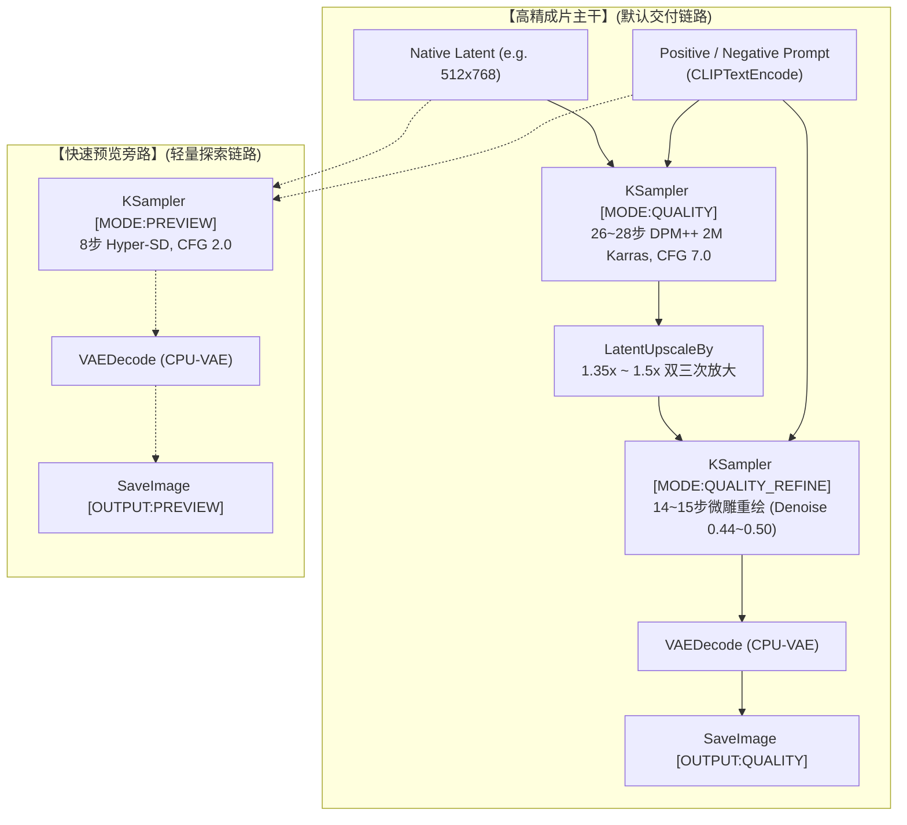

# 🤖 ComfyUI 工业级双轨工作流 Agent 调度使用指南 (Machine-Readable Contract)

> **适用对象**：自主代码大模型（LLM Agent，包括 Google Antigravity, Anthropic Claude, OpenAI Codex/ChatGPT, OpenCode, AutoGPT 等）。  
> **核心目标**：使 Agent 能够零摩擦、程序化地控制本地 ComfyUI 服务端，按需调度 17 套经过严格质量巡检与双轨标准化的工作流，生成工业级高画质图像，并具备全套自愈防御能力。

---

## 一、 Agent 核心执行契约 (Executive Principles)

1. **质量绝对优先原则 (Quality-First Invariant)**：
   - 用户明确指示：“**只保留一个快速抽卡生图的工作流（04 号），其他的都要以确保质量为前提，杜绝差图**”。
   - 当人类用户未显式要求“快速粗览/草图”时，Agent **必须默认调度【高精主干】（`[MODE:QUALITY]` 与 `[OUTPUT:QUALITY]`）**。
   - 严禁将 8 步蒸馏（Hyper-SD）直接作为最终交付成片交付给用户。
2. **纯本地无损通信 (Local API Loop)**：
   - 默认服务地址：`http://127.0.0.1:8284`（可通过环境变量 `COMFYUI_PORT` 自适应）。
   - Agent 与 ComfyUI 之间的一切交互均通过标准 REST HTTP API（`/prompt`, `/history`, `/view`, `/queue`, `/interrupt`）完成，无需模拟浏览器点击。
3. **二次元防模糊红线 (Anti-Blur Cel-Shading Rule)**：
   - 在调度二次元风格（WF05~12, 17）时，**绝对禁止混入真人写实 LoRA（如 `KoreanDollLikeness`）**。
   - 负向提示词必须显式注入：`oil painting, painterly, brush strokes, blurry, soft edges`；
   - 正向提示词推荐置顶强化：`(sharp clean anime lineart:1.35), (crisp 2D cel shading:1.3)`。

---

## 二、 双轨拓扑架构与调度逻辑

每个生成类工作流在拓扑上均具备“主路成片”与“旁路预览”双轨设计：



### 调度决策表 (Decision Table)

| 用户意图场景 | Agent 调度动作 | 目标工作流 | 执行链路 |
| :--- | :--- | :--- | :--- |
| **标准日常出图 / 最终交付成片** | 依据风格匹配对应工作流 | WF01, 02, 06~12, 15~17 | 执行至 `[OUTPUT:QUALITY]` |
| **快速抽卡 / 盲盒灵感探索** | 调度指定极速探索流 | **`04_极速抽卡_无限多风格探索流`** | 执行单轨极速探索 |
| **对话式多轮预览 / 构图确认** | 仅生成粗览样张供快速选择 | 任一生成流 | 仅执行至 `[OUTPUT:PREVIEW]` 节点 |
| **已有图片修补 / 局部重绘** | 传入图像与遮罩 (Mask) | `13_实用工具_局部重绘` | 26 步 DPM++ 重绘 (Denoise 0.65) |
| **姿态骨骼线稿约束生图** | 传入骨骼图或线稿 | `14_精准控制_ControlNet` | OpenPose / Canny 约束双轨微雕 |
| **分析反推参考图风格与词汇** | 传入待分析参考图 | `03_智能工具_NSFW提示词反推` | 提取中英双轨标签与自然语言 |

---

## 三、 零硬编码机器索引清单 (`workflows_manifest.json`) 与 API 目录

为了让网关与智能体摆脱针对特定文件路径与节点 ID 的硬编码，仓库根目录提供了权威全局索引 **[`workflows_manifest.json`](./workflows_manifest.json)**，所有纯 API 执行图存放在 **[`workflows_api/`](./workflows_api/)** 目录中。

### 1. 机器索引结构规范
```json
{
  "01": {
    "name": "01_真人写实_极致NanoBanana",
    "description": "电影级胶片写实人像，真实皮肤微观毛孔与耳廓次表面透光",
    "api_file": "workflows_api/01_真人写实_极致NanoBanana_次表面透析_电影双段精雕流.json",
    "ui_file": "workflows/01_真人写实_极致NanoBanana_次表面透析_电影双段精雕流.json",
    "style_tags": ["真人", "写实", "肖像", "摄影", "电影质感", "photorealistic", "portrait"],
    "prompt_node": { "id": "2", "field": "text" },
    "negative_node": { "id": "3", "field": "text" },
    "sampler_node": { "id": "5", "seed_field": "seed", "steps_field": "steps", "cfg_field": "cfg", "denoise_field": "denoise" },
    "refine_sampler_node": { "id": "7", "seed_field": "seed", "steps_field": "steps", "denoise_field": "denoise" },
    "preview_sampler_node": { "id": "12", "seed_field": "seed", "steps_field": "steps" },
    "output_node": "9",
    "preview_output_node": "14",
    "default_size": { "width": 512, "height": 768 },
    "checkpoint_node": { "id": "1", "model_field": "ckpt_name" }
  }
}
```

### 2. 17 套工作流关键节点速查表 (Node ID Map)

| 工作流 ID | 工作流名称 | 正向词 (Node ID) | 负向词 (Node ID) | 尺寸 Latent (Node ID) | 高精采样 1 (Node ID) | 微雕采样 2 (Node ID) | 成片保存 (Node ID) |
| :---: | :--- | :---: | :---: | :---: | :---: | :---: | :---: |
| **01** | 真人写实·NanoBanana | `"2"` | `"3"` | `"4"` | `"5"` (26步) | `"7"` (14步) | `"9"` |
| **02** | 抓拍视角·POV画中画 | `"2"` | `"3"` | `"4"` | `"5"` (26步) | `"7"` (14步) | `"9"` |
| **03** | 提示词反推工作台 | 载入图 `"1"` | 排除词 `"2"` | N/A (分析工具) | N/A | N/A | 展示 `"3"`~`"6"` |
| **04** | 极速抽卡·无限多风格 | 动态池 `"4"` | `"5"` | `"6"` | `"7"` (8步极速) | 无微雕 | `"9"` |
| **05** | 二次元风格总控台 | `"5"` | `"6"` | `"7"` | `"8"` (26步) | `"10"` (14步) | `"12"` |
| **06** | 吉卜力唯美手绘风 | `"4"` | `"5"` | `"6"` | `"7"` (26步) | `"9"` (14步) | `"11"` |
| **07** | 新海诚光影日漫 | `"4"` | `"5"` | `"6"` | `"7"` (26步) | `"9"` (14步) | `"11"` |
| **08** | 二次元暗黑深渊 | `"4"` | `"5"` | `"6"` | `"7"` (26步) | `"9"` (14步) | `"11"` |
| **09** | 2D精细厚涂修女 | `"4"` | `"5"` | `"6"` | `"7"` (26步) | `"9"` (14步) | `"11"` |
| **10** | 4大经典主题总控 | 主题词 `"3"`~`"6"` | `"8"` | `"9"` | `"10"` (26步) | `"12"` (14步) | `"14"` |
| **11** | 材质强化沙箱 | 角色 `"3"`, 材质 `"4"` | `"6"` | `"7"` | `"8"` (26步) | `"10"` (14步) | `"12"` |
| **12** | BetterWaifu姿态总控 | 正向姿态 `"4"` | `"5"` | `"6"` | `"7"` (26步) | `"9"` (14步) | `"11"` |
| **13** | 局部重绘修图流 | 重绘目标 `"5"` | `"6"` | 垫图/遮罩 `"3"`, `"4"`| `"7"` (26步重绘) | N/A | `"9"` |
| **14** | ControlNet姿态控制 | 引导词 `"4"` | `"5"` | 骨骼图 `"3"` | `"8"` (26步控制) | `"10"` (14步) | `"12"` |
| **15** | 生活写实写真流 | 场景词 `"3"` | `"4"` | `"5"` | `"6"` (26步) | `"8"` (14步) | `"10"` |
| **16** | 宽屏风光壁纸流 | 风光词 `"2"` | `"3"` | `"4"` (896x512) | `"5"` (26步) | `"7"` (14步) | `"9"` |
| **17** | 角色设定三视图 | 设定集词 `"2"` | `"5"` | `"6"` (832x512) | `"7"` (28步) | `"9"` (15步) | `"11"` |

---

## 四、 Agent 程序化调度标准代码范式 (Python SDK)

Agent 可直接调用已加固的 [`scripts/comfy_agent_client.py`](./scripts/comfy_agent_client.py)，支持 **零硬编码 Manifest 驱动调度** 与 **端到端冒烟测试**：

### 1. 冒烟测试执行（建议在 Agent 首次连接环境时自检）
```bash
python scripts/comfy_agent_client.py --test
```
该命令会自动自检服务健康度、读取 Manifest、调用 `04` 极速流派发生成任务、轮询队列并验证成片下载落盘。

### 2. 智能体程序化调用范式
```python
from scripts.comfy_agent_client import ComfyAgentClient

client = ComfyAgentClient("http://127.0.0.1:8284")

# 1. 根据风格标签或工作流编号匹配
wf_info = client.get_workflow_info("photorealistic")  # 或 client.get_workflow_info("01")
print(f"匹配到工作流: {wf_info['name']}")

# 2. 注入提示词并全自动运行（自动读取 manifest 解析 node ID）
images = client.run_generation(
    wf_id_or_path="01",
    prompt="masterpiece, best quality, ultra-detailed, photorealistic portrait, soft volumetric lighting",
    negative="lowres, bad anatomy, bad hands, blurry",
    output_dir="./downloads"
)

print(f"已下载交付成片: {images}")
```

---

## 五、 提示词工程规范 (SD 1.5 Prompt Engineering)

Agent 在为用户编写或优化 Prompt 时，必须遵循以下权重法则：

1. **语法结构**：
   - 强调词权重：`(keyword:1.2)` 至 `(keyword:1.35)`。严禁超过 `1.5`，否则会引发画面过度饱和或伪影撕裂。
   - 弱化词权重：`(unwanted:0.8)`。
2. **写实人像黄金模板 (WF01, 02, 15)**：
   - **Positive**: `masterpiece, best quality, ultra-detailed, 8k resolution, photorealistic, (natural skin texture, visible pores:1.25), (subsurface scattering:1.2), soft ambient natural lighting, highly detailed eyes, 35mm film photography, raw candid photograph`
   - **Negative**: `lowres, bad anatomy, bad hands, bad feet, missing fingers, extra digits, deformed, blurry, 3d render, cgi, anime, illustration, doll, wax, smooth plastic face, oversaturated`
3. **二次元纯净赛璐珞黄金模板 (WF05~12, 17)**：
   - **Positive**: `masterpiece, best quality, ultra-detailed, 8k resolution, (sharp clean anime lineart:1.35), (crisp 2D cel shading:1.3), vibrant studio anime aesthetic, intricate pupils, smooth gradients`
   - **Negative**: `lowres, bad anatomy, bad hands, missing fingers, extra digits, deformed, blurry, 3d render, cgi, oil painting, painterly, heavy brush strokes, waxy, muddy colors`

---

## 六、 故障自检与自愈指引 (Agent Self-Healing Playbook)

| 异常代码 / 现象 | 根因诊断 | Agent 自愈操作 |
| :--- | :--- | :--- |
| **HTTP 500: CUDA OOM / Allocation Error** | 显存瞬间峰值超限（常见于大分辨率 Latent 放大） | 1. 降低 `LatentUpscaleBy` 的 `scale_by`（从 1.5x 调整为 1.35x）；<br/>2. 确认启动脚本中已配置 `--cpu-vae` 与 `--reserve-vram 0.9`；<br/>3. 执行 `POST /interrupt` 并重试。 |
| **任务卡在队列长时间不推进 (`status: running` > 300s)** | ROCm 驱动临时死锁或前序任务卡死 | 1. 发送 `POST /interrupt` 强行终止当前任务；<br/>2. 查询 `GET /queue` 确认待定队列已释放；<br/>3. 重新提交当前任务。 |
| **生成结果全黑 (Black Image / NaN)** | VAE 溢出或浮点数下溢 | 1. 强制换用 `vae-ft-mse-840000-ema-pruned.safetensors`；<br/>2. 校验模型是否在 CPU 运行 VAE 解码（`--cpu-vae`）。 |
| **生成的二次元人像边缘发灰、有双重重影** | 存在被遗留的 FreeU 节点 | 确认工作流中已完全旁路或删除 `FreeU_V2` 节点。 |
| **HTTP 404: Node not found (`NSFW_WD14_Interrogator`)** | 自定义节点未加载 | 检查 `custom_nodes/ComfyUI-NSFW-Interrogator` 是否存在，重启 ComfyUI。 |

---

## 七、 非人萌物/吉祥物/宝可梦高审美微调与防畸变红线 (Creature & Mascot Aesthetic Invariants)

在调度非人生物、吉祥物或动漫 IP 萌宠（如皮卡丘、伊布、各种吉祥物角色）时，必须遵守以下四道审美防御红线，杜绝丑图与人体异化：

1. **纯英文标准 IP 专有名词法则 (English-Only Standard IP Rule)**：
   - SD 1.5 底层 CLIP ViT-L/14 为纯英文编码器。中文输入（如“皮卡丘”）无法激活其潜空间的概念先验，会直接退化为底模默认的真人肖像先验。
   - 调度必须使用标准英文名称强化：`pikachu, pokemon, (official pokemon company anime movie screencap:1.35), (extremely adorable cute pikachu:1.4)`。
2. **形态隔离与人体解剖学污染防御 (Morphological Isolation & Anti-Human Traps)**：
   - 动漫底模（如 Anything V5）在生成非人萌物时，容易在其平滑圆润的腹部或躯干错误投射人类生理器官（如肚脐、乳沟、生殖沟壑、人腿指节）。
   - **负向提示词必须强制注入形态隔离阻断词**：
     `human body, human torso, human legs, navel, belly button, cleavage, breasts, groin, weird folds, human skin`。
3. **真实动物词义联想陷阱回避 (Word Association Trap Avoidance)**：
   - 严禁为了描述属性添加真实啮齿动物词汇（如 `mouse, rat, rodent`），会导致模型联想野生啮齿动物并画出尖牙、牙龈与凶狠表情；
   - 负向词显式屏蔽：`creepy, angry, feral, rodent teeth, rat face, fangs, gums`。
4. **平涂赛璐珞重绘幅度 (Refine Denoise Threshold)**：
   - 真人与复杂写实场景的 Refine 重绘幅度通常为 `0.44 ~ 0.52`；
   - 但对色块平滑纯净的 2D 动漫萌物，重绘幅度高于 `0.40` 会凭空在平坦腹部与脸颊上“雕刻”出多余的人体褶皱与杂乱阴影；
   - **动漫萌宠/平涂角色的 Refine 重绘幅度黄金区间必须控制在：`0.35 ~ 0.38`**。既能超分强化眼睛星芒、光影反射与边缘闭合线，又绝不破坏纯净萌感。

---

## 八、 多维立体 LoRA 资产分类矩阵与智能意图路由器 (Multi-Dimensional LoRA Taxonomy & Smart Intent Router)

为了彻底解决“输入一句话就想出好图，不用人工挑选工作流与 LoRA”的问题，系统已建立 **多维立体分类矩阵** 并原生集成在 SDK 中（[`loras_manifest.json`](./loras_manifest.json) 与 [`scripts/comfy_agent_client.py`](./scripts/comfy_agent_client.py)）。

### 1. 五大核心分类维度 (Taxonomy Matrix)

| 分类大项 | 代表风格与 LoRA | 触发关键词示例 | 底模绑定 | 核心防护特征 |
| :--- | :--- | :--- | :--- | :--- |
| **潮玩萌物与手办 (`toys_and_mascots`)** | • 泡泡玛特盲盒 (`blindbox_V1Mix`)<br/>• 粘土定格泥塑 (`ClayAnimationRedmond`)<br/>• 日系Figma手办 (`figmaAnimeFigures`)<br/>• 16-bit像素 (`PixelArtRedmond`)<br/>• 民间立体剪纸 (`KK_paperCut`) | 盲盒、手办、泡泡玛特、粘土、泥塑、像素、剪纸、皮卡丘、动物、吉祥物 | `anything-v5` | **强制注入形态隔离负向词**：`human body, navel, groin`，彻底阻断人体肉褶与尖牙 |
| **东方美学与国风古韵 (`eastern_guofeng`)** | • 墨心·写意水墨 (`Moxin_10`)<br/>• 墨心·数客走马泼墨行书 (`Moxin_Shukezouma`)<br/>• 国风彩墨水彩 (`Colorwater_v4`) | 水墨、写意、山水、花鸟、泼墨、书法、武侠、国风、彩墨 | `anything-v5` | **防油画与防CG**：注入诗意留白提示词，剔除厚重油画与现代塑料感 |
| **大师商业插画 (`master_illustration`)** | • 吉卜力水彩童话 (`ghibli_style_offset`)<br/>• 新海诚光影日漫 (`anime-lora-makoto-shinkai`)<br/>• Sam Yang商业半厚涂 (`samdoesartsSamYang`)<br/>• 机甲科幻外骨骼 (`mecha(mjstyle)`)<br/>• 游戏纯净立绘 (`tachi-e`) | 宫崎骏、吉卜力、新海诚、黄昏天空、半厚涂、机甲、外骨骼、赛博朋克、全身立绘 | `anything-v5` | **赛璐珞与光影微雕**：注入对应流派光影与边缘闭合线，Denoise 控制在 `0.38` |
| **人像素描与写真 (`portraits_and_faces`)** | • 亚洲电影胶片肖像 (`koreanDollLikeness`)<br/>• 甜美二次元灵动美少女 (`cuteGirlMix4`) | 真人、写实、肖像、摄影、35mm、胶片、毛孔、美女、写真 | `Realistic_Vision` | **写实人像微观毛孔**：仅当明确为人像摄影时才挂载，Denoise 开启 `0.46` |
| **工业级通用质感外挂 (`utility_enhancers`)** | • 8K微观细节微雕 (`more_details`)<br/>• 8步极速加速引擎 (`Hyper-SD15`)<br/>• 纯净极简背景控制 (`simple_background`) | 高清、细节强化、锐化、极速抽卡、秒级、白底、极简背景 | 泛用自适应 | 通用外挂，按需提升画面解析度与清晰度 |

### 2. 自动化拉取与 GitHub 归档管理

```bash
# 自动化一键拉取全部 LoRA 并落盘至 G 盘（支持断点续传与已有跳过）
python scripts/download_loras.py

# 仅拉取特定分类（如潮玩手办）
python scripts/download_loras.py --category toys_and_mascots
```

* **GitHub 归档规范**：
  1. 代码仓仅维护轻量 `loras_manifest.json` 与 `scripts/download_loras.py`（< 100KB），杜绝巨型二进制挤占 git 历史；
  2. 资产防删永久备份通过 GitHub Releases（`gh release upload`）归档，实现 100% 离线与可复现。

### 3. Agent 智能意图路由调用代码

```python
from scripts.comfy_agent_client import ComfyAgentClient

client = ComfyAgentClient("http://127.0.0.1:8284")

# 零摩擦一键出图：Agent 自动分析意图、匹配底模、装配对应 LoRA、注入防畸变负向词
images, decision = client.smart_generate(
    prompt="一只可爱皮卡丘在阳光下吃苹果",
    mode="quality",
    output_dir="./downloads"
)

print(f"命中策略: {decision['rationale']}")
print(f"交付成片: {images}")
```


