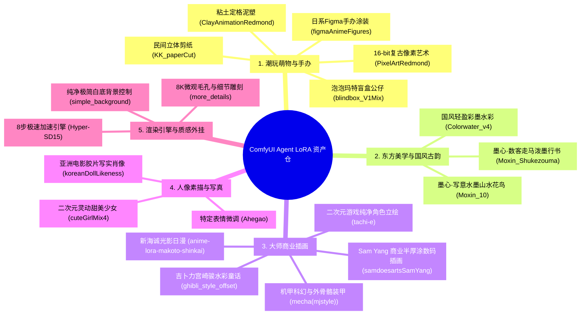

# 📦 多维立体 LoRA 资产图谱与自动化拉取 (LoRA Asset Matrix)

为了让无论是人类创作者还是自主代码智能体（Agent）都能一句话调用最顶级质感，本专版建立了 **5 大核心主维度、19 款高分经典 LoRA 矩阵**，且已全部落盘至本地存储仓（G 盘为主仓），ComfyUI 纯热重载即刻感知。

---

## 一、 五大核心分类维度与 19 款 LoRA 清单



---

## 二、 详细模型字典与触发规则

| LoRA 标识 | 模型文件名 | 推荐权重 | 适用底模 | 推荐触发词 (Trigger Words) |
| :--- | :--- | :---: | :--- | :--- |
| **`blindbox`** | `blindbox_V1Mix.safetensors` | `0.80` | `anything-v5` | `blindbox, full body, chibified, cute, plastic toy, smooth glossy finish` |
| **`clay_animation`** | `ClayAnimationRedmond15-ClayAnimation-Clay.safetensors` | `0.85` | `anything-v5` | `Clay Animation, claymation, plasticine texture, stop motion look` |
| **`figma_figures`** | `figmaAnimeFigures_figma.safetensors` | `0.75` | `anything-v5` | `figma, pvc figure, scale figure, painted figurine, display base` |
| **`pixel_art`** | `PixelArtRedmond15V-PixelArt-PIXARFK.safetensors` | `0.85` | `anything-v5` | `Pixel Art, 16-bit, pixelated, retro arcade game asset` |
| **`paper_cut`** | `KK_paperCut_v1.safetensors` | `0.80` | `anything-v5` | `paper cut, papercraft, layered paper, 3d shadow box art` |
| **`moxin_chinese_ink`**| `Moxin_10.safetensors` | `0.85` | `anything-v5` | `(moxin:1.2), chinese traditional ink painting, ink wash, poetic atmosphere` |
| **`moxin_shukezouma`** | `Moxin_Shukezouma11.safetensors` | `0.80` | `anything-v5` | `(shukezouma:1.2), dynamic chinese calligraphy brushwork, splashes of ink, wuxia` |
| **`colorwater_guofeng`**| `Colorwater_v4.safetensors` | `0.75` | `anything-v5` | `(colorwater:1.15), delicate watercolor wash, translucent ink bleed` |
| **`sam_yang_art`** | `samdoesartsSamYang_offsetRightFilesize.safetensors`| `0.80` | `anything-v5` | `sam yang style, samdoesarts, luminous skin, glowing rim light, stylized portrait`|
| **`mecha_cyberpunk`** | `mecha(mjstyle).safetensors` | `0.80` | `anything-v5` | `mecha, mechanical armor, exosuit, cybernetic parts, hard surface, machinery` |
| **`tachie_character`** | `tachi-e.safetensors` | `0.75` | `anything-v5` | `tachi-e, character design sheet, full body standing, clean outline, game asset` |
| **`ghibli_storybook`** | `ghibli_style_offset.safetensors` | `0.85` | `anything-v5` | `(studio ghibli style:1.35), hayao miyazaki, watercolor storybook texture` |
| **`shinkai_twilight`** | `anime-lora-makoto-shinkai-anime-style.safetensors` | `0.85` | `anything-v5` | `(makoto shinkai style:1.35), cinematic anime movie, twilight sky, reflections` |
| **`korean_doll`** | `koreanDollLikeness_v10.safetensors` | `0.70` | `Realistic_Vision` | `korean doll likeness, realistic female portrait, 35mm photograph` |
| **`cute_girl`** | `cuteGirlMix4_v10.safetensors` | `0.65` | `anything-v5` | `cute girl, anime aesthetic, youthful face` |
| **`more_details`** | `more_details.safetensors` | `0.45` | 泛用通用 | `more details, ultra-detailed, 8k resolution, crisp lines` |
| **`hyper_sd`** | `Hyper-SD15-8steps-CFG-lora.safetensors` | `1.00` | 泛用加速 | `fast draft` |
| **`simple_background`**| `simple_background_v2.safetensors` | `0.70` | 泛用通用 | `simple background, clean white background, minimalistic background` |

---

## 三、 自动化拉取与环境复刻

所有模型的直链、哈希与推荐参数均已标准化固化于 [`loras_manifest.json`](../loras_manifest.json)。

### 1. 一键补齐所有缺失 LoRA
```bash
python scripts/download_loras.py
```
* 自动检测目标路径（优先写入 G 盘，失败时自动退避到 C 盘）；
* 自动对比本地已有文件体积与哈希，已存在模型 **0 秒跳过**，仅流式并发下载缺失项。

### 2. 仅下载指定分类
```bash
# 仅拉取潮玩手办类
python scripts/download_loras.py --category toys_and_mascots

# 仅拉取国风水墨类
python scripts/download_loras.py --category eastern_guofeng
```
