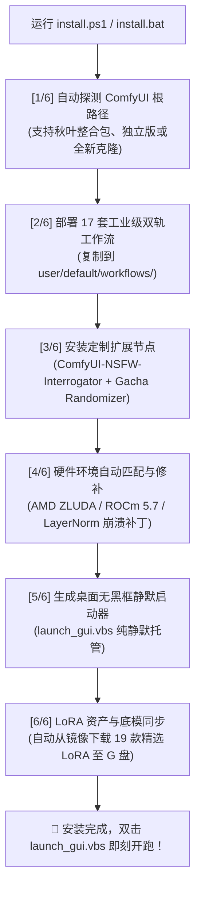

# 🚀 极速上手与一键安装指南 (Quick Start Guide)

本专版致力于将 ComfyUI 的搭建门槛降至零。无论您是拥有一台刚拆箱重装的全新电脑，还是希望在现有的秋叶整合包或官方独立版上进行升级，均可通过根目录下的**单一主脚本**闭环完成。

---

## 一、 最简命令行安装（单脚本）

### 1. 克隆代码仓库
```powershell
git clone https://github.com/deancyl/comfyui-agent-workflows.git
cd comfyui-agent-workflows
```

### 2. 运行单脚本安装器
```powershell
powershell -ExecutionPolicy Bypass -File .\install.ps1
```

> **Windows 桌面用户贴士**：  
> 您也可以直接在文件资源管理器中**双击 `install.bat`**，它会自动以管理员安全策略唤起 PowerShell 完成全套安装并暂停等待确认！

---

## 二、 `install.ps1` 内部全自动流水线

脚本在执行过程中会自动完成以下 6 个阶段的核验与部署：



---

## 三、 参数化高级用法

`install.ps1` 支持多种参数，便于自动化部署与 CI/CD 流水线：

| 参数名 | 默认值 | 作用与适用场景 |
| :--- | :--- | :--- |
| `-TargetDir "<路径>"` | 自动探测 | 指定目标 ComfyUI 路径（例如 `G:\ComfyUI\ComfyUI-aki\ComfyUI-aki-v3.2\ComfyUI`） |
| `-SkipModels` | `False` | 仅部署工作流、节点、补丁与启动器，跳过 LoRA 资产下载（适合网络受限场景） |
| `-NonInteractive` | `False` | 完全非交互式静默执行，遇到缺省参数自动采用标准默认值（适合运维脚本） |

### 示例：为秋叶整合包进行静默升级（跳过模型下载）
```powershell
powershell -ExecutionPolicy Bypass -File .\install.ps1 -TargetDir "G:\ComfyUI\ComfyUI-aki\ComfyUI-aki-v3.2\ComfyUI" -SkipModels -NonInteractive
```

---

## 四、 启动与日常使用

安装完成后，目标目录下会生成 **`launch_gui.vbs`**：
1. **双击 `launch_gui.vbs`**：
   - 0.5 秒内静默在后台拉起 ComfyUI 服务（AMD 780M 专用保命参数启动）；
   - 自动以独立 Edge 应用模式打开 `http://127.0.0.1:8284`；
   - **完全没有任何命令行黑框干扰**，宛如使用原厂桌面软件！
2. **命令行调试启动**：
   如果您想实时查看控制台采样进度或日志，可运行：
   ```powershell
   powershell -File .\start_zluda_amd.ps1 -Foreground
   ```
