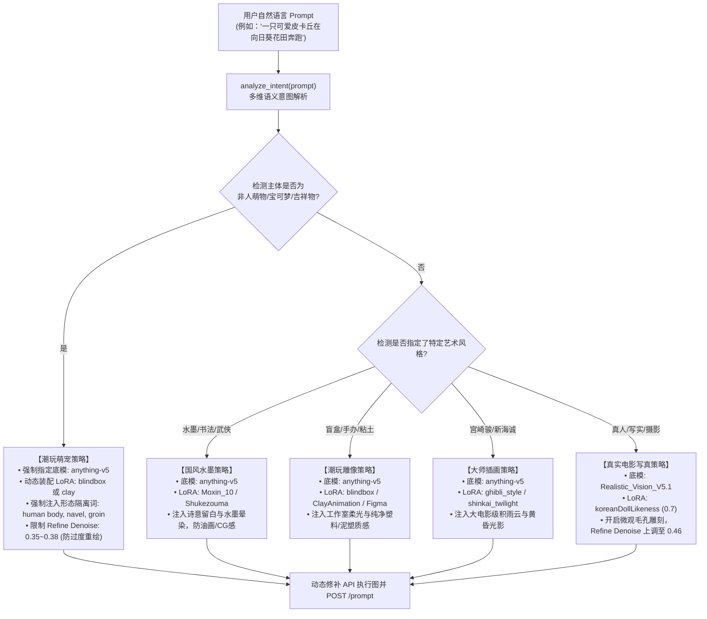

# 🧠 智能意图路由器与防畸变阻断机制 (Smart Intent Router Specification)

为了解决“用户输入一句话，系统不知道该调哪个工作流、该挂哪个底模和 LoRA”的张冠李戴问题，系统在 SDK 层（`comfy_agent_client.py`）原生构建了 **多维语义意图路由器 (Smart Intent Router)**。

---

## 一、 为什么必须在调度层做意图分析？

在传统 ComfyUI 流程中，如果直接在固定工作流中输入提示词，极易踩入两大致命陷阱：
1. **底模与主体冲突**：在写实底模（`Realistic_Vision`）中输入“皮卡丘/动漫少女”，模型因缺乏赛璐珞先验，会强行画出“长满真实黄毛、牙齿外翻的啮齿类动物标本”；
2. **LoRA 强行污染**：如果在挂载了女性肖像 LoRA（如 `KoreanDollLikeness`）的工作流里输入任何非人生物或男性，画面腹部和脸部会被强行雕刻出人类女性特征（肚脐、乳沟、生殖褶皱）。

因此，意图路由器在任务提交前执行 **【主体与风格语义拆解 ➔ 动态装配最佳底模 ➔ 挂载对应 LoRA ➔ 注入防畸变形态隔离词】** 的四位一体防护。

---

## 二、 路由器决策架构 (Routing Decision Logic)



---

## 三、 关键审美红线：形态隔离阻断词 (Morphological Isolation)

针对二次元大模型在圆润卡通萌宠身上过度脑补人体生理结构的通病，意图路由器在识别到 `is_mascot_creature` 时，**负向提示词中必须且强制注入以下形态隔离词**：

```text
human body, human torso, human legs, navel, belly button, cleavage, breasts, groin, weird folds, human skin, creepy, angry, feral, rodent teeth, rat face, fangs, gums, lowres, blurry
```

* **阻断效果**：彻底抹平腹部类似“肚脐/生殖沟壑”的人体肉褶，消除尖牙利齿的老鼠脸，使画面 100% 保持圆润萌感。

---

## 四、 命令行与 SDK 调用范式

### 1. 语义自检（仅输出决策方案，不占显存，毫秒级返回）
```bash
python scripts/comfy_agent_client.py --analyze "一只可爱皮卡丘在向日葵花田奔跑"
```

### 2. 智能出图（全自动匹配并交付）
```bash
python scripts/comfy_agent_client.py --smart "一只可爱皮卡丘在向日葵花田奔跑"
```

### 3. Python SDK 代码集成
```python
from scripts.comfy_agent_client import ComfyAgentClient

client = ComfyAgentClient("http://127.0.0.1:8284")

# 零摩擦智能生图
images, decision = client.smart_generate(
    prompt="云雾缭绕的水墨黄山，孤舟蓑笠翁",
    output_dir="./downloads"
)

print(f"命中的流派: {decision['category']}")
print(f"装配的 LoRA: {decision['lora_name']} (权重: {decision['lora_weight']})")
print(f"决策原由: {decision['rationale']}")
print(f"保存的文件: {images}")
```
