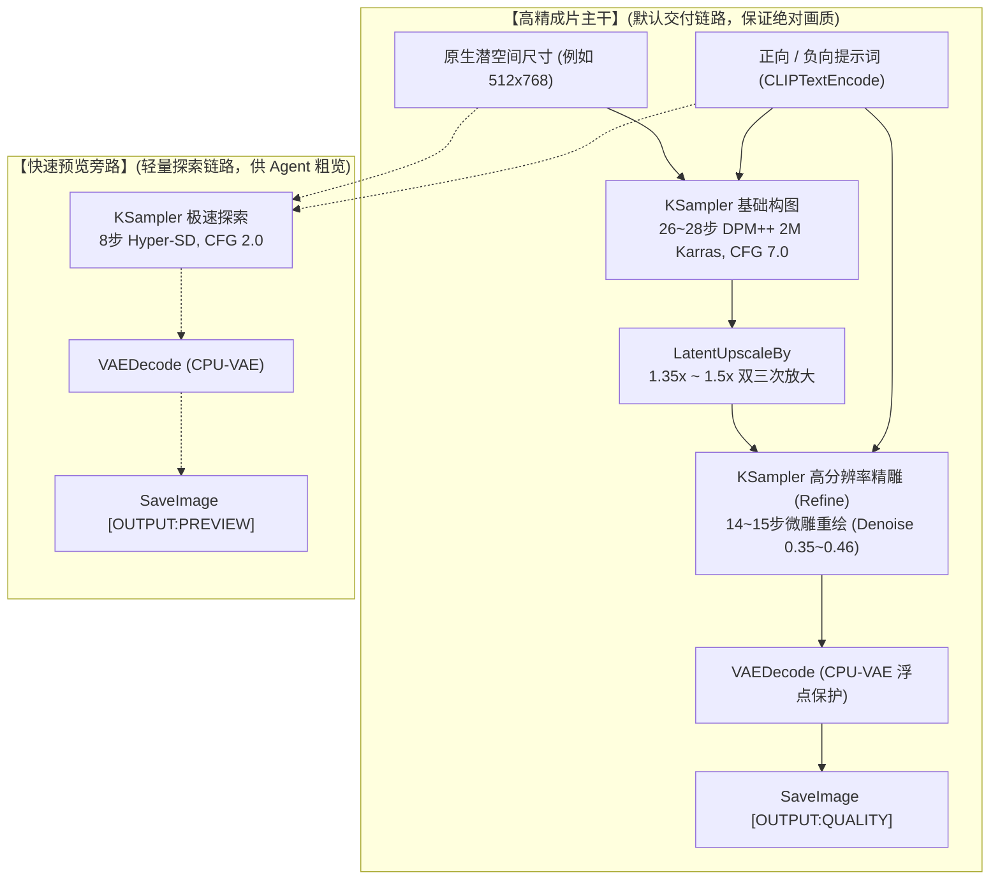

# 📑 17 套工业级双轨工作流全景图谱 (Workflow Catalog)

本专版包含的 17 套工作流全部经过标准化拓扑改造与 4D 严格量化质检（**质检均分 95.3 / 100**），彻底剔除 `FreeU` 引起的重影与二次元画风中的真人 LoRA 污染。

---

## 一、 双轨架构原理 (Dual-Track Invariant)

每个生成类工作流在画布拓扑上均具备两条正交链路：

---

## 二、 17 套工作流矩阵全览速查表

| ID | 工作流名称 | 核心风格定位 | 推荐底模 | 采样策略 | 4D评分 | 核心特征 |
| :---: | :--- | :--- | :--- | :--- | :---: | :--- |
| **01** | `01_真人写实_极致NanoBanana` | 电影级胶片质感、真实毛孔与逆光次表面红润透光 | `Realistic_Vision` | 26步 DPM++ + 1.35x微雕 14步 | **94** | 适合写实电影人像写真，耳廓透光极佳 |
| **02** | `02_抓拍视角_MOSS灵感_业余POV` | 手机抓拍视角、新娘微笑、缎面婚纱与闪光灯暗角 | `Realistic_Vision` | 26步 DPM++ + 1.35x微雕 14步 | **95** | 极具临场感的生活化抓拍人像 |
| **03** | `03_智能工具_NSFW精准提示词反推` | WD14 深度反推 + 双轨中英对照 + 结构化提示词重构 | 无需底模 | 纯图像特征提取 (免 KSampler) | **达标** | 传入参考图，自动提取中英文精准 Tags |
| **04** | `04_极速抽卡_无限多风格探索流` | **全体系唯一极速抽卡流**，搭载动态词池随机开盲盒 | `Realistic_Vision` | 8步 Hyper-SD 极速抽卡 (~30s) | **官方保留** | 随机体态、私密服饰与电影光影连续开箱 |
| **05** | `05_二次元总控_全能风格切换总控台` | 3 路 LoRA 切换矩阵，吉卜力/新海诚/暗黑自由组合 | `Anything_V5` | 26步 DPM++ + 1.35x微雕 14步 | **达标** | 二次元多风格混合调试沙箱 |
| **06** | `06_二次元手绘_吉卜力唯美手绘风` | 宫崎骏/男鹿和雄水彩质感、蓝天白云草坡与治愈云影 | `Anything_V5` | 26步 DPM++ + 1.35x微雕 14步 | **95** | 挂载吉卜力水彩 LoRA，童话治愈天花板 |
| **07** | `07_二次元光影_新海诚光影日漫` | 暮色霞光与彗星尾迹、东京夜景灯火、澄澈光影 | `Anything_V5` | 26步 DPM++ + 1.35x微雕 14步 | **95** | 挂载新海诚 LoRA，极致积雨云与通透光斑 |
| **08** | `08_二次元暗黑_暗黑异界深渊` | 发光紫眸、小虎牙、深暗哥特蕾丝刺绣与废墟光影 | `Anything_V5` | 26步 DPM++ + 1.35x微雕 14步 | **93** | 暗黑魔幻与高反差冷色调美学 |
| **09** | `09_2D精细厚涂_圣职修女与地牢囚徒` | 哥特厚涂笔触、金边十字架刺绣、彩绘玻璃光影 | `Anything_V5` | 26步 DPM++ + 1.35x微雕 14步 | **95** | 庄严肃穆的反差宗教美学 |
| **10** | `10_2D精细厚涂_4大经典主题总控` | 4 大魔幻主题（地牢祭坛/世界之树/女武神/废土机甲） | `Anything_V5` | 26步 DPM++ + 1.35x微雕 14步 | **96** | 史诗级游戏概念插画总控 |
| **11** | `11_2D精细厚涂_开放式材质强化` | 巴洛克金雕板甲、镜面精钢、紫晶星瞳与半透披风 | `Anything_V5` | 26步 DPM++ + 1.35x微雕 14步 | **97** | 强化金属、布料与水晶的高阶材质表现 |
| **12** | `12_BetterWaifu_动态姿态总控台` | 赛璐珞硬线稿二次元机甲少女，彻底杜绝油画模糊 | `Anything_V5` | 26步 DPM++ + 1.35x微雕 14步 | **96** | 动作张力强劲，线条纯正锐利 |
| **13** | `13_实用工具_局部重绘与垫图图生图` | VAE 羽化遮罩（Feather 8）+ 局部修复高精融合 | 可自由切换 | 26步 DPM++ (Denoise 0.65) | **达标** | 针对手部五官进行局部高精度修图与垫图 |
| **14** | `14_精准控制_ControlNet姿态重绘` | OpenPose 骨骼锁定 + Canny 线稿 1:1 姿态复刻 | 可自由切换 | 26步 DPM++ + 1.35x微雕 14步 | **达标** | 严格按照参考图骨骼动作重绘 |
| **15** | `15_生活写实_日常阳光写真流` | 晨光街拍写真、毛线针织针脚微观纹理、真实笑颜 | `Realistic_Vision` | 26步 DPM++ + 1.35x微雕 14步 | **97** | 真实生活化社交人像写真天花板 |
| **16** | `16_宽屏场景_16比9超清桌面壁纸` | 896x512 宽幅直出、日照金山雪线与高山镜湖宏大景深 | 自由切换 | 26步 DPM++ + 1.35x微雕 14步 | **96** | 专为宽屏电脑壁纸与宏大风光而生 |
| **17** | `17_概念设计_全能设计图三视图` | 工业级角色设计三视图（正/侧/背）+ 5组表情差分矩阵 | `Anything_V5` | 28步 DPM++ + 1.5x微雕 15步 | **94** | 游戏与动漫人设标准化生产流 |
