# 系统架构与核心机制 (Architecture)

本文档详细阐述 OpenCode Go Router 智能网关的设计哲学、架构分层以及关键技术机制。

---

## 🏛️ 系统架构全景图

```mermaid
flowchart TD
    subgraph ClientLayer["客户端接入层 (Client Ecosystem)"]
        CLI["OpenCode CLI v2"]
        Chamber["OpenChamber Web / Desktop"]
        Codex["OpenAI Codex CLI / ChatGPT App"]
        OMO["Oh My OpenAgent (多智能体)"]
        Goal["Goal 推进体系 (/goal, /boost)"]
    end

    subgraph GatewayLayer["高可用智能路由网关 (opencode-go-router:4010)"]
        Auth["局域网安全鉴权门禁 (Cookie + Bearer Token)"]
        
        subgraph ProtocolBridge["智能双向协议桥 (Protocol Bridges)"]
            P_Responses["OpenAI Responses API 桥 (Codex 专用)"]
            P_Chat["OpenAI ChatCompletions 代理桥"]
            P_Anthropic["Anthropic Messages 代理桥 (x-api-key 双轨鉴权)"]
            P_Direct["原生透传反向代理"]
        end

        subgraph CompactorCore["无损上下文优化与 Token 压缩引擎 (Context Compactor)"]
            Card1["Card 1: RTK 终端去噪 (ANSI / 进度条 / 测试项正向折叠)"]
            Card2["Card 2: Headroom 结构化折叠 (Lockfiles / SmartCrusher JSON采样)"]
            Card3["Card 3: 工具定义优化 (CacheAligner 字典序锁 KV Cache / Schema 瘦身)"]
            Card4["Card 4: llmtrim 会话缓存固化 (sessionCompressionMemo / True LRU)"]
            Card5["Card 5: Windows PowerShell 优化 (转义自愈 / CLIXML 去噪 / 平台自适应)"]
            Telemetry["大盘遥测: 官方模型费率字典感知 + By-Model 动态加权费用测算"]
            CompDoctor["压缩体检: Compression Doctor & Auto-Repair 防降智防断联屏障"]
        end
        
        subgraph FlowControl["流量治理与自愈内核 (Resilience Kernel)"]
            SessionIso["动态会话强隔离 (Dynamic Session Derivation)"]
            Affinity["会话亲和性锁定 (Session Affinity / Cache Lock)"]
            SchemaNorm["动态工具 Schema 深度规范化 (inputSchema/parameters)"]
            ErrorClean["非200错误清洗屏障 (Sanitization Barrier)"]
            FallbackEng["异构推理集群模型无感跃迁引擎"]
            Watchdog["SSE 10s心跳保活 + 300s停滞看门狗"]
        end

        subgraph LoadBalancer["多账号负载均衡器 (Account Pool)"]
            RR["加权轮询 / 状态健康检查"]
            Failover["零感 429 故障转移 (Failover)"]
            Cooldown["智能 Retry-After 冷却管理器"]
            QuotaMonitor["官方滑动窗口配额监控 (5h / 7d / 30d)"]
        end
    end

    subgraph UpstreamLayer["OpenCode Zen 聚合上游"]
        Acc1["OpenCode Go 订阅账号 1 ($10/月)"]
        Acc2["OpenCode Go 订阅账号 2 ($10/月)"]
        AccN["... 扩展多账号池"]
    end

    ClientLayer --> Auth
    Auth --> ProtocolBridge
    ProtocolBridge --> CompactorCore
    CompactorCore --> FlowControl
    FlowControl --> LoadBalancer
    LoadBalancer --> UpstreamLayer
```

---

## 🔑 核心技术机制深度解析

### 1. 动态会话隔离 (Dynamic Session Derivation)
- **痛点**：多端或多标签页并发请求时，若采用静态共享 Session ID，上游推理节点会发生状态冲突，导致正在推理的前序会话被直接掐断（报 `aborted`）。
- **机制**：网关优先从客户端请求头 `x-opencode-session`、`x-conversation-id`、`x-request-id` 以及 Responses 请求体中的 `previous_response_id` 中动态派生强隔离的唯一哈希标识，确保多会话并发零冲突。

### 2. 会话亲和性 (Session Affinity) 与 Prompt Cache 锁定
- **机制**：针对同属于一个工作流或连续对话的请求，网关将其严格绑定在同一上游订阅账号上；
- **价值**：极大提升上游 KV 缓存 (Prompt Cache) 命中率，推理首字延迟降低 60% 以上，并大幅节约 Token 消耗。

### 3. 零感 429 故障转移 (Failover) 与智能冷却
- **机制**：当当前账号返回 `429 Too Many Requests` 或 `503 Service Unavailable` 时，网关捕获响应并在内存中瞬间将请求切换到备用账号重试；
- **智能冷却**：解析响应头中的 `retry-after`，将受限账号置入冷却队列，冷却期结束后自动重新纳入调度池。整个切换过程对上层客户端完全透明，杜绝任务中断。

### 4. 异构推理集群模型无感跃迁 (In-Flight Fallback)
- **痛点**：上游 Zen 聚合层接入了多家异构推理集群。部分受限节点对模型名称有苛刻白名单，传入新版全名（如 `deepseek-v4.1-flash`）会抛出：
  `The supported API model names are deepseek-flash, deepseek-v4-pro, but you passed deepseek-v4.1-flash.`
- **机制**：网关内置正则提取器毫秒级解析上游返回的受支持模型列表，按同梯级（Flash $\to$ Flash、Pro $\to$ Pro）与族谱前缀推导等位模型，并在网关层透明重放当前轮次，客户端 100% 零感知。

### 5. 动态工具 Schema 规范化与网关错误清洗屏障
- **Schema 规范化**：全面探测 `parameters`、`inputSchema` 与 `input_schema`，杜绝空参数降级为空对象 `{}` 引发严校验上游集群 400 崩溃；强制补齐 `{ type: 'object', properties: {} }`。
- **错误清洗屏障**：拦截非 200 响应，强制剥离 `content-encoding` 干扰，将上游 0 字节 SSE 空流或非标裸 JSON 统一包装为规范的 OpenAI Error 结构，消除客户端红框气泡与空气泡。

### 6. 无损上下文优化与多层 Token 压缩引擎 (Context Compactor)
- **Card 1 终端与日志去噪 (RTK / Token-Saver)**：剔除 ANSI 控制字符、合并 `\r` 覆盖式终端进度条并严格保全 Windows CRLF 换行、正向匹配折叠测试通过用例（原样保留所有失败断言与堆栈）、安全折叠 DevOps 运维输出（Docker/Terraform）；
- **Card 2 结构化与代码折叠 (Headroom SmartCrusher)**：自动折叠巨型 lockfile 差异（覆盖 npm, yarn, pnpm, cargo, bun, uv 等）；针对 >50 项同构 JSON 数组执行智能采样；遇到 Git 冲突标记（`<<<<<<<` 等）100% 绝对豁免免折叠，严格恪守防降智红线；
- **Card 3 工具定义优化 (CacheAligner & mcp-compressor)**：Tools Schema 字典序排序与去除冗余空白，锁定上游 KV Cache 前缀（命中率提升至 80%~90%）；超大 Schema 自动裁剪多行 Markdown 代码样例；
- **Card 4 会话缓存区固化 (llmtrim Cache-Zone)**：多轮对话历史消息单次压缩固化在 `sessionCompressionMemo`，复用字节级一致文本避免重新计算；配备 Bounded True LRU 内存防护；
- **Card 5 Windows 平台自适应与 PowerShell 转义自愈**：自愈路径末尾反斜杠吃引号、curl.exe 别名修正、`&&` 操作符转换为兼容语法、反斜杠续行转换为反引号；去噪 `#< CLIXML` 冗长报错与 hex 转义；在 Linux/NAS 自动保持零开销休眠旁路；
- **官方费率动态感知字典与分模型动态加权测算**：实时追踪 `byModel` 模型独立节约指标，按 OpenCode 官方实时费率动态加权精确计算 USD 金额；
- **压缩体检与自愈诊断 (Compression Doctor & Repair)**：提供 `/balancer/api/compression/doctor` 与 `/balancer/api/compression/repair`，秒级自检 3 大客户端兼容性与安全红线，一键自愈恢复安全配置。
