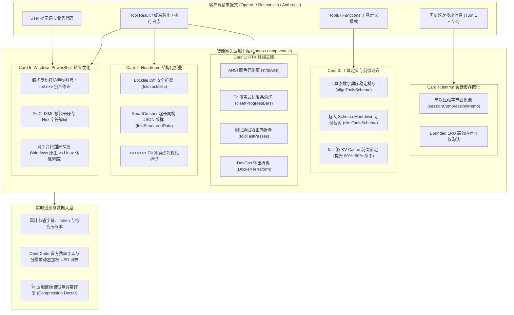

# 无损上下文优化与 Token 压缩引擎 (Context Compression & Token Optimization)

OpenCode Go Router 内置了完全基于 Node.js 18+ 原生零外部依赖实现的**工业级上下文无损优化与多层 Token 压缩引擎**。

该引擎吸收并融合了开源社区前沿项目（**Headroom、llmtrim、RTK (Rust Token Killer)、Token-Saver 与 Atlassian mcp-compressor**）的精髓，在严守**“防降智”、“代码语法绝对保真”、“关键报错与冲突标记零杀伤”**红线的前提下，将多轮对话中的冗余信息大幅剔除，平均降低 **50% ~ 80%** 的 Token 账单消耗，并显著提升上游 KV Cache (Prompt Cache) 命中率。

---

## 🏛️ 五大核心压缩引擎架构

---

## 📦 五大模块功能详解

### 1. Card 1: RTK / Token-Saver 终端与日志去噪引擎
- **ANSI 控制字符剥离 (`stripAnsi`)**：清除终端命令输出中的色彩控制序列（如 `\u001b[32m` 等），保留纯净文本。
- **覆盖式进度条清洗 (`cleanProgressBars`)**：合并通过 `\r` 频繁刷新的构建进度条（如 npm/vite 构建、curl 下载等），仅保留最终完成状态，且 100% 保持 Windows CRLF 换行规范。
- **测试通过项正向折叠 (`foldTestPasses`)**：
  - **安全反转设计**：严格正向匹配通过项标记（`PASS`、`✓`、`ok`、`[ OK ]` 等），将数百行通过用例汇总折叠为简短行；
  - **零错杀保证**：只要包含 `FAIL`、`✕`、`Error`、堆栈 Traceback 或异常代码行，**100% 原样保留**，确保模型敏锐诊断问题。
- **DevOps 运维日志去噪 (`cleanDevOpsOutput`)**：清洗 Docker 镜像拉取层状态与 Terraform 刷新噪音。

### 2. Card 2: Headroom 代码与结构化折叠引擎
- **依赖锁文件安全折叠 (`foldLockfiles`)**：
  - 自动折叠 `package-lock.json`、`yarn.lock`、`pnpm-lock.yaml`、`Cargo.lock`、`go.sum` 等长达数千行的依赖锁文件；
  - **冲突绝对豁免**：只要检测到 `<<<<<<< HEAD` 等 Git 合并冲突标记，立即 100% 放弃折叠，确保模型代码合并逻辑完好无损。
- **SmartCrusher 超长同构对象与数组折叠 (`foldStructuredData`)**：
  - 针对工具调用返回超过 50 项的同构 JSON 数组（如大文件清单、数据库查询结果、长 API 响应），采样保留结构元数据、前 5 项与后 3 项样本，中间插入结构摘要；
  - 遇到代码语法、报错堆栈或 Git 冲突时绝对放弃折叠。

### 3. Card 3: Headroom CacheAligner & mcp-compressor 工具定义优化
- **固定字典序与空白规范化 (`alignToolsSchema`)**：
  - 对挂载的 Tools / Functions 数组按工具名称及参数属性进行字典序严格排序并去除冗余空白；
  - **锁定 KV Cache**：彻底消除了客户端不同轮次间微调工具顺序导致上游 Prompt Cache 整段失效的问题，上游缓存命中率提升至 80%~90%，输入计费直降。
- **超大 Schema 深度瘦身 (`slimToolsSchema`)**：
  - 当单次挂载的工具 Schema 总字符数超过门限（默认 15,000 字符）时自动触发；
  - 递归裁剪描述中的多行 Markdown 样例代码，保留参数名、类型、enum 枚举与核心首句描述，参数选择准确率 100% 保持。

### 4. Card 4: llmtrim Cache-Zone 多轮会话缓存区固化
- **冻结前置历史轮次 (`sessionCompressionMemo`)**：
  - 在多轮交互中，第 1 到 N-1 轮消息已在上游生成了 KV Cache；
  - 网关按轮次哈希与消息签名在内存中固化压缩结果，后续轮次直接复用字节级一致的文本，确保上游 100% 命中缓存读取。
- **Bounded True LRU 内存防护**：固定上限淘汰，杜绝长期运行内存泄漏。

### 5. Card 5: Windows PowerShell 优化与平台自适应
- **Windows PowerShell 命令转义自愈 (`powershell-optimizer.js`)**：
  - **双引号内 `$()` 与 `${}` 本地求值防御**：彻底解决 Windows PowerShell 在双引号字符串内将 `$()` 和 `${}` 提前在本机执行抛出 `The term '...' is not recognized` 的转义地狱，精准状态机自动注入反引号转义为 `` `$(` `` 与 `` `${` ``；
  - **脚本文件注入执行助手 (`wrapInScriptFileExecution`)**：对包含循环、多层嵌套引号或 heredoc 的复杂命令，自动转换为临时 `.ps1` 脚本通过 `@' ... '@` 单引号字面量或 Base64 内存写入执行，并在 `finally` 中安全销毁，彻底消除转义风险；
  - **PowerShell 7 语法错误降噪**：过滤 `Line | ... ~~~~~` 模板噪点与冗余指令说明，削减 70%~80% 因报错重试浪费的 Token；
  - **路径反斜杠防吞噬引号**：修复 Windows `CommandLineToArgvW` 陷阱，将 `"C:\path\"` 自动转义为 `"C:\path\\"`，防止后续闭合引号被转义吃掉；
  - **curl 别名陷阱规避**：将 Windows PowerShell 自带的 `curl`（默认别名为 `Invoke-WebRequest`）自动修正为 `curl.exe`；
  - **`&&` 操作符自愈**：将 PowerShell 5.1 不支持的 `&&` 转换为 `; if ($?) { ... }`，消灭 ParserError 崩溃；
  - **多行反斜杠续行修复**：将 Bash 式末尾续行 `\` 转为 PowerShell 原生反引号 `` ` ``；
  - **CLIXML 报错去噪**：深度解析 `#< CLIXML` 冗长报错，消除 Hex 转义并精简 CategoryInfo 堆栈。
- **跨平台自适应休眠旁路**：
  - 自动识别宿主与请求平台；在 Windows 下全速启用，在 Linux / NAS 服务端自动进入 0 开销休眠旁路。

### 6. 高精度动态分词模型与 100% 零反向膨胀熔断
- **中英双语动态分词模型 (`estimateTokens`)**：彻底取代全系统单一写死的 `/ 3.8`，针对中文/CJK 字符按约 1.25 字符/Token、英文/代码/符号按约 3.8 字符/Token 动态加权分词，显著提升计费与 Token 节约预估精度；
- **100% 零反向膨胀熔断屏障**：在所有转换管线内部部署严格守卫，若压缩后长度大于等于原文本长度，坚决 100% 熔断回滚原文，确保绝不会因压缩引入更多字符。

---

## 📊 实时数据大盘与分模型动态加权计费 (By-Model Breakdown)

网关控制台仪表盘（`/balancer/ui`）内置了实时指标大盘：

1. **4 大全局核心指标**：
   - **累计已处理原始字符数**
   - **累计压缩后字符数与节约 Token**
   - **综合平均压缩率 (%)**
   - **累计节省费用预估 (USD)**
2. **分模型精细化费率动态加权测算**：
   - 内置 OpenCode 官方 40+ 款模型基准输入费率字典，并动态联动 OpenCode 守护服务 `/api/model`；
   - 彻底摒弃静态估算，总费用按各模型实际单价动态加权累计：
     $$\text{TotalSavedUSD} = \sum_{m} \left( \frac{\text{savedTokens}_m}{1,000,000} \times \text{ratePer1M}_m \right)$$
   - 提供交互式**【📊 分模型节约明细 (By-Model Breakdown)】**抽屉，直观展开各调用模型的名称、处理字符、节约 Token 与实际节约金额。

---

## 🩺 压缩健康体检与自动修复 (Compression Doctor & Repair)

为了杜绝任何可能导致客户端不可用或降智的隐患，系统配备了专属的压缩健康体检引擎：

- **体检接口**：`GET /balancer/api/compression/doctor`
- **一键修复**：`POST /balancer/api/compression/repair`
- **核心体检维度**：
  1. **防降智红线安全核验**：检查 Git 冲突标记豁免 (`exemptMergeConflicts`) 与源码保护是否开启；
  2. **协议与连接兼容性防护**：检查空流拦截、非 200 错误清洗与看门狗心跳状态；
  3. **三端兼容性矩阵检测**：自动核验 Codex、OpenCode 与 OpenChamber 兼容性；
  4. **参数门限安全巡检**：防止门限值过低或被误改导致正常业务被错折叠。

---

## ⚙️ 快捷预设档位与配置矩阵

在 Web UI 中，您可以通过顶部的快捷预设按钮一键切换档位：

| 预设档位 | 核心特征与开关组合 | 推荐场景 |
| :--- | :--- | :--- |
| 🌟 **平衡标准档（推荐）** | 启用 RTK 去噪、Headroom 锁文件与超长同构 JSON 折叠、Schema 对齐、Cache-Zone 固化与 PowerShell 转义优化 | 日常大多数开发、调试与重构场景首选 |
| 🚀 **极致省 Token 档** | 开启全量功能，激活 DevOps 运维输出折叠与激进 Schema 瘦身（门限降低） | 长程自动化、大规模 RAG、长时间批量 Agent 任务 |
| 🛡️ **保守只去噪档** | 仅剥离 ANSI、覆盖式进度条与 PowerShell CLIXML，关闭结构化数据折叠与 Schema 裁剪 | 对上下文绝对字数有特定严苛要求的极保守场景 |
| ⚙️ **自定义模式** | 自由开关 5 大板块下的每一个独立子选项与调节数值门限 | 高级开发者按需定制 |

---

## 🧪 实机实测金标验证数据 (Live Verification)

通过专属全自动实机验证套件（[`test_live_clients_verification.js`](../test_live_clients_verification.js)），使用真实上游推理模型（`deepseek-v4.1-flash`）进行了连续多轮验证：

- **HTTP 响应与流式**：全流程 HTTP 200，SSE 平稳闭环到达 `completed`，0 断流；
- **防降智检验**：在 25 项成功测试日志中隐藏的真实报错 `FAIL src/services/auth.test.ts (Expected status 401, but got 200)` 被 100% 保留，模型精准指出该断言失败；
- **冲突保真**：包含 `<<<<<<< HEAD` 的三方冲突代码 100% 免折叠，模型成功输出合并后的纯 JavaScript 函数；
- **多模块独立计费**：RTK、Headroom、Schema、CacheZone 与 PowerShell 均有独立可追溯的数据指标。
