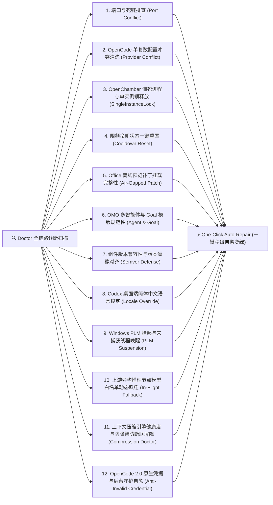

# 全链路体检诊断与自动自愈体系 (Doctor & Repair)

本文档介绍 OpenCode Go Router 内置的 **Doctor 全自动体检诊断与一键自愈引擎** 的设计与实现。

---

## 🩺 诊断与自愈能力全景

网关提供统一的诊断接口（`/balancer/api/doctor`）与自动修复接口（`/balancer/api/repair`），覆盖 10 大核心维度的系统性环境排查：

---

## 🛠️ 自愈机制重点详解

### 1. OpenCode 2.0+ 单复数提供商配置冲突清洗
- **病症**：`opencode.jsonc` 中同时存在 `provider`（单数）与 `providers`（复数）时，OpenCode 启动会抛出规范化诊断冲突，甚至降级直连官方上游；
- **自愈**：将第三方自定义模型统一合流进单数 `provider`，全量注入官方 38 款高可用模型清单，并彻底安全清除外层旧复数键。

### 2. OpenChamber 桌面端僵死死锁释放
- **病症**：后台残留无窗口僵死 Electron 进程（`MainWindowHandle == 0`），霸占 `SingleInstanceLock`，导致用户双击图标无任何反应（秒退）；
- **自愈**：枚举检测后台无窗口实例，强力终止并释放互斥锁，随后脱钩拉起正常窗口。

### 3. Codex 语言锁定与 UWP PLM 挂起唤醒
- **病症**：更新配置后 Codex 界面回退为英文，或被 Windows 进程生命周期管理器（PLM）冻结挂起；
- **自愈**：补齐 `[desktop].localeOverride = "zh-CN"` 并写入 Chromium 语言参数；枚举并恢复被挂起的线程。

### 4. 上游模型受限报错动态自愈
- **病症**：上游返回 `The supported API model names are deepseek-flash, deepseek-v4-pro, but you passed deepseek-v4.1-flash`；
- **自愈**：动态正则提取支持的模型池，按同梯级等位推导并透明重放当前请求，向客户端无感输出。

### 5. 上下文压缩引擎健康自检与防降智防断联屏障 (Compression Doctor)
- **病症**：开发者误改配置导致安全门限过低、关闭了 Git 冲突豁免 (`exemptMergeConflicts`)，或客户端配置异常引发断流；
- **自愈**：专用子体检接口 `/balancer/api/compression/doctor` 与修复接口 `/balancer/api/compression/repair`；秒级核验 Codex、OpenCode、OpenChamber 三端兼容性状态，一键强制恢复至黄金“平衡标准档”安全配置，杜绝模型降智与代码语法破损。

### 6. OpenCode 2.0 原生凭据与后台守护自愈 (Anti-Invalid Credential)
- **病症**：OpenCode 发送消息时报错 `Upstream request failed: Invalid credential`，因原生 SQLite 凭据库与用户配置脱节；
- **自愈**：原生利用 Node.js `node:sqlite` 同步写入 `opencode.db` 的 `credential` 表与 `auth.json`，在 Linux NAS 自动配置 `opencode-server.service` 环境变量并平滑重启，在 Windows 端持久化写入当前用户环境变量 `OPENCODE_API_KEY`；100% 完整保护既有第三方凭据。

### 7. 事务级事前灾备备份留痕与非破坏性合并 (Angle 9)
- **红线**：严禁在修复损坏或轻微格式问题的 JSON/JSONC/TOML 配置文件时，未经备份就直接用默认模板覆盖用户已有内容（如 API Key 与路由规则）；
- **自愈机制**：
  1. **毫秒级时间戳备份**：所有修改在写入前必须自动生成独立时间戳副本（如 `opencode.jsonc.bak.<yyyyMMdd_HHmmss_fff>`）；
  2. **非破坏性深层合流**：自动识别并保留第三方 provider、自定义 baseURL、用户自选默认模型及所有定制参数；
  3. **端口释放特征白名单**：核验进程命令行（`node`、`electron`、`opencode`、`openchamber`、`server.js` 等），杜绝误杀用户第三方进程；
  4. **四元组结构化诊断报告**：自愈执行后格式化输出：`[异常项 (Issue)] | [根因说明 (Root Cause)] | [已执行修复动作 (Action Taken)] | [灾备快照点 (Snapshot)]`。

---

## 💻 调起体检与自愈的方法

- **Web 控制台**：登录后台 `http://<IP>:4010/balancer/ui`，点击顶栏或卡片中的 **【🩺 一键体检】** 与 **【⚡ 一键修复】**；
- **Windows 终端**：运行 `powershell -ExecutionPolicy Bypass -File .\doctor-repair.ps1 -AutoFix`；
- **Linux / NAS 终端**：运行 `./setup-linux.sh --doctor` 或 `./setup-linux.sh --repair`。
