# OpenCode Go Router 官方文档中心 (Wiki)

欢迎查阅 **OpenCode Go Router & Full-Stack Toolkit** 官方技术文档与知识库。

本项目是一套专为 **OpenCode、OpenAI Codex、OpenChamber** 等 AI 编程智能体生态打造的高可用聚合网关与上下文无损压缩中枢。全面支持 **Windows 10/11 桌面端** 以及 **Linux / NAS 私有服务器环境（Debian、Ubuntu、fnOS 飞牛私有云、群晖 Synology DSM、TrueNAS、Docker）**。

---

## 🎯 核心能力与用户价值

### 它干了什么？
1. **多账号无感容灾轮询 (Failover)**：聚合多 API 账号，遭遇 HTTP 429 限频时毫秒级静默漂移至备用账号，长任务与代码生成不断流。
2. **确定性无损 Token 压缩 (Context Compactor)**：自动清洗终端 ANSI 杂音、折叠构建刷屏日志与超大 JSON 数据。源码、Diff 与堆栈 100% 豁免绝对不降智，严格保护上游 KV Cache。
3. **全协议多模态统一桥接 (Unified Protocol Bridge)**：原生双向转换 OpenAI Responses ↔ ChatCompletions / Anthropic 协议；解锁全量思考等级；内置 ComfyUI 极速生图与本地离线 Office 安全预览沙箱。
4. **跨平台原生常驻与全链路自愈 (Self-Healing)**：Windows 下 Win32 原生托盘守护（零黑框终端）+ Linux/NAS systemd 用户守护；端口占用与单实例死锁自动自愈。

### 对使用者有什么实际影响？
- 💰 **大幅降本**：Token 账单开销直接降低 **60% ~ 85%**，长会话大幅省钱。
- 🛡️ **长任务永不中断**：复杂长流程、大重构任务不再因单账号限频或节点抖动报错崩溃。
- 💻 **桌面纯净无扰**：日常与自启零 cmd/powershell 黑色控制台弹框，独立桌面 App 级交互。
- ⚡ **30 秒开箱即用**：全套生态一键自动深度绑定，43 款模型全景对齐，Codex 界面完整汉化。

---

## 🗺️ 文档导航图谱

```mermaid
flowchart TD
    Home["📖 文档中心首页 (Home)"]
    QS["⚡ 快速开始 (Quick Start)"]
    Arch["🏛️ 系统架构与核心原理 (Architecture)"]
    Codex["🤖 Codex CLI / ChatGPT 接入 (Codex Integration)"]
    NAS["🐧 Linux & NAS 部署指南 (Linux/NAS Guide)"]
    Win["🪟 Windows 桌面端使用指南 (Windows Guide)"]
    Office["📄 Air-Gapped Office 离线预览 (Office Engine)"]
    Compress["⚡ 无损上下文优化与 Token 压缩 (Context Compactor)"]
    Doctor["🩺 全链路体检与故障自愈 (Doctor & Repair)"]
    Update["📦 组件安全更新与快照回滚 (Updater & Rollback)"]
    API["🔌 API 接口与路由清单 (API Reference)"]
    FAQ["❓ 常见问题与故障速查 (FAQ & Troubleshooting)"]

    Home --> QS
    Home --> Arch
    Home --> Codex
    Home --> NAS
    Home --> Win
    Home --> Office
    Home --> Compress
    Home --> Doctor
    Home --> Update
    Home --> API
    Home --> FAQ
```

---

## 📚 知识库目录索引

| 序号 | 文档名称 | 核心内容概述 | 适用人群 |
| :---: | :--- | :--- | :---: |
| 01 | [快速开始 (Quick Start)](Quick-Start.md) | Windows 桌面双击向导、Linux/NAS 极速一键部署、30秒完成双账号与生态绑定 | 新手与快速接入 |
| 02 | [系统架构与核心机制 (Architecture)](Architecture.md) | 智能路由网关设计、会话亲和性 (Prompt Cache)、429 智能故障转移、动态 Session 隔离 | 架构师与系统工程师 |
| 03 | [OpenAI Codex CLI 智能接入 (Codex Integration)](Codex-Integration.md) | Responses ↔ ChatCompletions 实时双向流协议转换、全谱系思考等级解锁、中文语言覆盖、PLM 挂起与死锁自愈 | Codex / ChatGPT 开发者 |
| 04 | [无损上下文优化与 Token 压缩 (Context Compression)](Context-Compression.md) | RTK 去噪、Headroom 结构化折叠、Schema 锁 KV Cache、llmtrim 缓存固化、PowerShell 转义优化与分模型动态加权计费 | 追求极速与低费率的开发者 |
| 05 | [Linux 与 NAS 服务器部署 (Linux/NAS Guide)](Linux-NAS-Deployment.md) | systemd 用户级常驻守护、多存储卷探测（fnOS、群晖 DSM、TrueNAS）、Docker 卷映射、局域网安全访问与鉴权 | NAS 与私有云用户 |
| 06 | [Windows 桌面端无黑框体验 (Windows Guide)](Windows-Desktop-Guide.md) | C# 原生托盘守护、Win32 顶级窗体消息下沉、全栈快捷方式引导器、独立桌面 App 模式、开机自启 | Windows 桌面用户 |
| 07 | [Air-Gapped Office 离线安全预览 (Office Engine)](Air-Gapped-Office.md) | 纯本地离线 DOCX/XLSX/PPTX 高保真解析沙箱、安全红线隔离、双轨本地原厂 Office/WPS 联动 | 办公文档与私有安全用户 |
| 08 | [全链路体检诊断与自动自愈 (Doctor & Repair)](Doctor-Self-Healing.md) | 端口死链自愈、配置单复数冲突合流、单实例互斥锁释放、动态异构模型白名单跃迁、压缩引擎健康体检 | 运维与系统自愈 |
| 09 | [组件安全更新与快照回滚 (Updater & Rollback)](Updater-Rollback.md) | 5 大核心组件跨版本监测、破坏性变更深度分析、升级前全量快照与秒级无损回滚 | 长期维护者 |
| 10 | [API 接口参考清单 (API Reference)](API-Reference.md) | 网关控制台 API、官方配额监测 API、模型热同步 API、文件安全打开 API、压缩大盘与健康探针 | API 二次开发与集成 |
| 11 | [常见问题与故障速查 (FAQ & Troubleshooting)](FAQ-Troubleshooting.md) | 高频报错排查速查表、上游模型名限制报错应对、网络超时与空流排障 | 全体开发者 |

---

## 💡 快速提示

- **新手接入**：先阅读 **[快速开始 (Quick Start)](Quick-Start.md)**；
- **Codex / ChatGPT 用户**：直接参考 **[Codex CLI 智能接入指南](Codex-Integration.md)**；
- **私有云 / NAS 用户**：参阅 **[Linux 与 NAS 服务器部署指南](Linux-NAS-Deployment.md)**。
